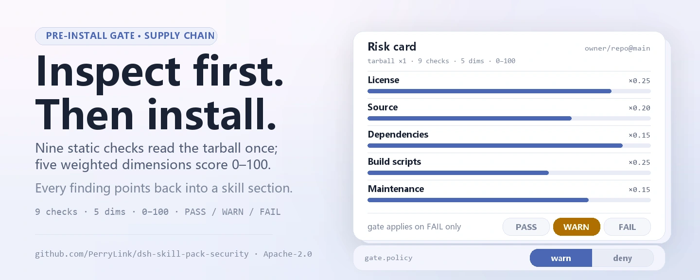
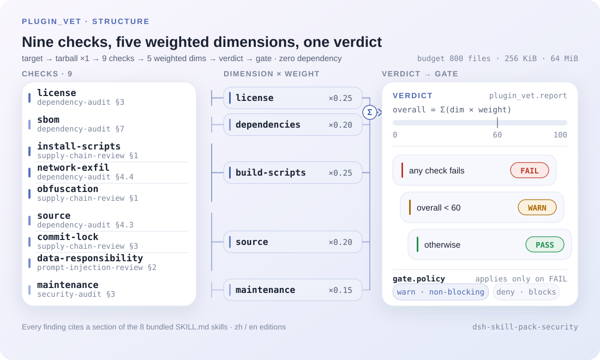
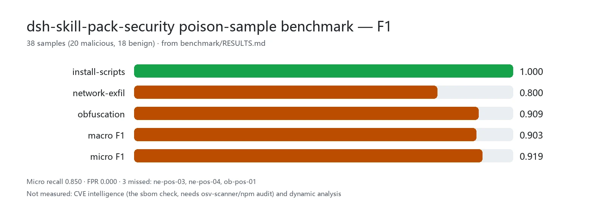

<div align="center">

<picture>
  <source media="(prefers-color-scheme: dark)" srcset="docs/assets/dsh-skill-pack-security-hero-en-dark.webp">
  
</picture>

# dsh-skill-pack-security

**Lay the supply-chain risk out before `dsh plugin add` — the verdict, not a hunch, decides the install.**

Eight security-audit skills plus an automated pre-install gate for DeepSeek Harness: the skills teach the methodology, `plugin_vet` runs the mechanical checks, and every finding points back into a skill section.

[Install](#three-step-setup) · [Configuration](#configuration) · [FAQ](#faq) · [简体中文](README.md) · [English](README.en.md) · [Español](README.es.md) · [Português](README.pt.md) · [हिन्दी](README.hi.md)

[](LICENSE)
[](#compatibility)
[](https://github.com/PerryLink/dsh-skill-pack-security/actions/workflows/verify.yml)
[](#compatibility)

[](https://github.com/PerryLink/dsh-skill-pack-security/stargazers)
[](https://dshfind.com/plugins/PerryLink/dsh-skill-pack-security?ref=badge)
[](https://securityscorecards.dev/viewer/?uri=github.com/PerryLink/dsh-skill-pack-security)
[](https://dsh.market/)
[](https://gitee.com/perrylink/dsh-skill-pack-security)

```sh
dsh plugin --profile <name> add dsh-skill-pack-security
```

</div>

<sub>Community plugin, not affiliated with DeepSeek. Canonical repository: <https://github.com/PerryLink/dsh-skill-pack-security> (Gitee is a mirror).</sub>

<sub>This project has moved to **[dsh-security-pack](https://github.com/PerryLink/dsh-security-pack)**: this repository stays as a pointer/backup and new work happens there; the old npm package `@perrylink/dsh-skill-pack-security-provider` is deprecated.</sub>

## What it is

`dsh-skill-pack-security` is a **skill pack plus a supply-chain gate**. Eight security methodologies ship as `SKILL.md` bundles the model discovers in its session catalog and loads on demand, while `plugin_vet` runs the mechanical pre-install checks — license, SBOM, commit locking, lifecycle scripts and exfil domains, a five-dimension risk card — and closes with PASS / WARN / FAIL. The skills answer "how do I audit this"; the tool answers "what does the package look like before I install it"; both share one vocabulary and one set of section numbers. The root package is a private bundle manifest; the runnable package is `@perrylink/dsh-skill-pack-security-provider`.

```text
owner/repo ──tarball (once)──▶ plugin_vet ──▶ license · sbom · commit-lock
                                              lifecycle · exfil · obfuscation
                                              data-responsibility
                                     │
                                     ▼
                    risk card (5 dims x 0-100) ──▶ PASS | WARN | FAIL ──▶ gate.policy
```

<picture>
  <source media="(prefers-color-scheme: dark)" srcset="docs/assets/dsh-skill-pack-security-flow-v5-dark.svg">
  
</picture>

## Three-step setup

1. **Install** (pick one channel; the runnable package is the provider):

   ```sh
   # git channel (latest main)
   dsh plugin --profile web add github:PerryLink/dsh-skill-pack-security
   # npm channel (published releases, with provenance)
   dsh plugin --profile web add @perrylink/dsh-skill-pack-security-provider
   # tarball channel: pnpm pack inside provider/, then
   dsh plugin --profile web add ./@perrylink-dsh-skill-pack-security-provider-<version>.tgz
   ```

   `prepack` embeds both editions — `skills/` (Chinese) and `skills-en/` (English) — into the tarball; the row that mounts is the one in `provider/cordis.patch.yml`.

2. **Minimal config** (defaults to the Chinese edition; one key switches it):

   ```yaml
   - insert:
       - id: skill-pack-security
         name: '@perrylink/dsh-skill-pack-security-provider'
         config:
           language: en
   ```

3. **Verify it mounts**:

   ```sh
   dsh --profile web --dump-config | grep -A3 'id: skill-pack-security'
   ```

   Then have the model load `security-audit` with the `skill` tool and call `plugin_vet` once against any `owner/repo` — a rendered risk card means it works.

**Uninstall**: `dsh plugin --profile web remove @perrylink/dsh-skill-pack-security-provider` (or remove the row; pure-skill copies are removed with the installer's `-Uninstall` / `--uninstall`).

<details>
<summary>Install from the DSH Desktop market</summary>

Every PerryLink plugin is listed in the built-in DSH Desktop market: **Market → Sources → Add source → paste** `https://perrylink-dsh-catalog.perrylink.workers.dev/catalog-source.json` **→ select**. Installation still requires the market's npm identity check and your confirmation.

</details>

### Installing the skills by hand

You do not need the provider to use the skills. DSH's local skill provider scans four roots by rank (lower rank wins same-name conflicts within a layer):

| Rank | Root | Scope |
|---|---|---|
| 100 | `<projectRoot>/.dsh/skills` | Project-scoped, travels with the repo |
| 200 | `<projectRoot>/.agents/skills` | Project-scoped, shared agent directory |
| 400 | `<dshHome>/skills` (`$DSH_HOME` or `~/.dsh`) | User-scoped, DSH-only |
| 500 | `<agentsHome>/skills` (`$DSH_AGENTS_HOME` or `~/.agents`) | User-scoped, cross-agent |

Rank chain (lower wins a same-name conflict within a layer): `project-dsh 100 < project-agents 200 < custom 300 < user-dsh 400 < user-agents 500`. Custom rank 300 is the plugin-registered layer (such as this pack's optional `provider/`), not a disk root.

```powershell
./scripts/install.ps1 -Target user-agents -Language zh   # Target: project-dsh | project-agents | user-dsh | user-agents; Language: zh (default) | en
```

```sh
bash ./scripts/install.sh --target user-agents --language en
```

## Core capabilities

- **Eight skills, two editions** — every skill ships with identical names and metadata in `skills/` (Chinese) and `skills-en/` (English); install one language per root.
- **`plugin_vet` gate** — a zero-dependency scanner registered on `ctx.tools` by the optional `provider/` plugin (license / SBOM / commit locking / malicious patterns / data-responsibility review / five-dimension risk card).
- **Findings cite the skills** — every finding points to the matching skill section (for example `supply-chain-review §1`) so the agent can continue the manual audit.
- **Executable by a model** — each skill step is a real command (`gitleaks`, `trivy`, `pnpm audit`, `npm view`, `git …`) with an expected-output sample and an exit-code criterion.

### The eight skills

| Skill | Purpose | When to use |
|---|---|---|
| `security-audit` | Five-phase audit flow: scope → inventory → risk tiering → verification → report template | Whole-repo audits, audit reports, planning |
| `secret-scan` | Credential audit: gitleaks/trivy usage, false-positive tiers, redacted reports, remediation order | Secret scanning, alert triage, leak reports |
| `dependency-audit` | Supply-chain audit: pnpm/npm audit reading, licenses, typosquat risk, lockfile drift | Dependency review, audit-report interpretation |
| `supply-chain-review` | Quick PR/new-dependency review: dangerous install scripts, typosquat, reproducible builds | Reviewing PRs that add dependencies |
| `prompt-injection-review` | Injection-surface review for agent projects: AGENTS.md, skills, tool descriptions, MCP, web | Reviewing model-context injection surfaces |
| `threat-model` | Design-stage threat modeling: trust boundaries, STRIDE table, attack trees, mitigations | Modeling new features, design-stage security review |
| `vuln-intel` | Vulnerability intelligence: NVD/CISA-KEV/GHSA/OSV lookups with verdict criteria | Given a CVE/GHSA id, checking impact and exploitation |
| `incident-response` | Agent-environment incident response: contain → evidence → recover → postmortem | Suspected security incidents in DSH/agent setups |

Each bundle keeps its main file ≤ 300 lines (progressive disclosure; details live in `references/`).

### plugin_vet — the automated pre-install gate

`plugin_vet` is the pack's automated complement: a zero-dependency scanner registered on `ctx.tools` by the `provider/` plugin. Point it at a GitHub `owner/repo` or a local package path — it downloads the tarball once (timeout + `AbortSignal` respected), scans within budget limits, and returns a render card.

- **License scan** — finds the LICENSE file and the `license` field; `NOASSERTION`/`UNKNOWN`/`SEE LICENSE IN <file>`, a missing file, or a missing field is flagged; common SPDX ids are recognized.
- **SBOM** — extracts the dependency tree with versions from the lockfile (pnpm/npm/yarn); when `osv-scanner` or `npm audit` is detected on a local target, their vulnerability output replaces the self-computed dependency scan and the report annotates the source (`builtin` / `osv-scanner` / `npm-audit`).
- **Commit locking** — install-manifest refs and workflow actions must be immutable 40-hex commit SHAs; `@tag`/branch refs are flagged as mutable.
- **Malicious patterns** — lifecycle scripts (`preinstall`/`install`/`postinstall`), network-exfiltration domains, and obfuscated/encoded payloads in shipped code.
- **Data-responsibility review** — the policy-scan dimensions as deterministic rules: ungated listeners on sensitive seams (`agent/pre-step`, `tools/pre-execute`, `session/event`, …), outbound endpoints without README telemetry/privacy disclosure, description-behavior keyword coverage, and embedded instruction-override payloads in shipped text (skills, docs, prompts, tests). Every finding cites `prompt-injection-review` for the manual deep-dive; disable per deployment with `vet.dataResponsibility: false`. A model-assisted review stage is the documented future upgrade.
- **Five-dimension risk report** — license / source / dependencies / build scripts / maintenance, each 0-100, folded into an overall verdict: PASS, WARN, or FAIL.

**Install gate.** The verdict feeds an installation gate — `gate.policy: warn` (default, non-blocking) prints a warning on FAIL; `gate.policy: deny` returns a deny verdict. The tool does not intercept the host's `dsh plugin add`; wire the verdict into your installer/CI to enforce it:

```yaml
- id: skill-pack-security
  name: '@perrylink/dsh-skill-pack-security-provider'
  config:
    language: en
    vet:
      gate:
        policy: deny   # return a deny verdict for targets that fail plugin_vet (caller enforces)
```

**Complementary to `dsh-plugin-check`.** The official plugin validator's 36 checks verify a plugin's *contract and quality* (config schema, effect registration, tool JSON shape); `plugin_vet` verifies the *supply chain* of where a plugin comes from. Run both:

| | `dsh-plugin-check` (36 checks) | `plugin_vet` (this repo) |
|---|---|---|
| Question answered | Is this plugin well-formed and contract-compliant? | Is this package safe to install? |
| Looks at | Plugin code, schema, registrations, tool contracts | LICENSE, lockfile, install refs/actions, lifecycle scripts, exfil/obfuscation, maintenance, data-responsibility (hooks scope, telemetry disclosure, description-behavior, embedded injection payloads) |
| Verdict | Pass/fail per check | PASS / WARN / FAIL + gate |
| When | Plugin development or review | Before `dsh plugin add`, PR review, CI supply-chain gate |
| Blocking | CI gate (non-zero on violations) | Configurable: `warn` (default) or `deny` |

### Why skills, not tools

| Shape | What it does | What it cannot do |
|---|---|---|
| Tool plugin (e.g. security scanners) | *Executes* scans, returns findings | Interpret alerts, tier false positives, write redacted reports |
| Protocol layer | *Constrains* a protocol | Generalize across repos and agents |
| **Skill pack (this repo)** | *Teaches methodology*: triage, reporting, remediation order — **and** automates the static pre-install checks via `plugin_vet` | Replace a manual audit end to end |

Installed together with a tool-type security plugin, the two compose: the tool runs the scan, the skill drives interpretation, triage, and the report. This pack combines both shapes: the skills teach the methodology, and `plugin_vet` runs the mechanical static subset automatically, with every finding pointing back into the skills.

The Claude Code ecosystem's 3000+ skills prove the distribution value of this shape. DSH's `SKILL.md` frontmatter (`name`, `description`, `whenToUse`) is format-compatible with CC skills; this pack uses only the common subset and its content is entirely original.

### Tools and surfaces

| Surface | Kind | Notes |
|---|---|---|
| `plugin_vet` | tool | Pre-install supply-chain scan (license / SBOM / commit lock / malicious / risk card); findings cite skill sections |
| `skill-pack-security` | skill provider | Registers the pack's `skills/` or `skills-en/` edition on `ctx.skills` |
| Eight `SKILL.md` bundles | skills | The audit methodology, in two language editions |
| install gate | gate | `vet.gate.policy: warn \| deny` returns a verdict; the caller (installer/CI) enforces it |

## Measured data

<picture>
  <source media="(prefers-color-scheme: dark)" srcset="docs/assets/dsh-skill-pack-security-evidence-en-dark.webp">
  
</picture>

The per-class detection rate / FPR / F1 over 38 poison samples (20 malicious, 18 benign) is published in [`benchmark/RESULTS.md`](benchmark/RESULTS.md); regenerate it with `pnpm --dir provider run build && node benchmark/run.mjs` (zero new dependencies). What is measured is the three malicious-pattern checks in the shipped engine — `installScriptsCheck`, `networkExfilCheck`, `obfuscationCheck`; only a `fail` verdict (the state that blocks an install under the `deny` policy) counts as a detection, a `warn` does not. Micro recall 0.850, macro F1 0.903, micro F1 0.919, zero false positives. The three missed samples and the gap against OSV/Socket are written out in RESULTS.md: these heuristics read shape only and carry no vulnerability database, so CVE intelligence belongs to the `sbom` check (needs `osv-scanner`/`npm audit`).

## Configuration

All tunables are Schemastery `Config` fields (changeable from cordis.yml). `provider/cordis.patch.yml` documents each key inline.

Most-used keys:

| Key | Default | Meaning |
|---|---|---|
| `language` | `zh` | Edition to publish: the Chinese `skills/` or the English `skills-en/`; ignored when `skillsDir` is set |
| `skillsDir` | *(unset)* | Explicit skills root; overrides the `language`-derived default and must hold `<skill>/SKILL.md` bundles |
| `vet.enable` | `true` | Register the `plugin_vet` gate tool |
| `vet.dataResponsibility` | `true` | Run the data-responsibility review (disable per deployment) |
| `vet.externalScanners` | `true` | Orchestrate `osv-scanner`/`npm audit` when their CLIs are present; `false` forces the built-in self-computed dependency scan |
| `vet.gate.policy` | `warn` | Install gate: `warn` (non-blocking) or `deny` (block on FAIL) |

<details>
<summary>Full configuration table (14 keys)</summary>

| Key | Default | Meaning |
|---|---|---|
| `language` | `zh` | Edition to publish: the Chinese `skills/` or the English `skills-en/`; ignored when `skillsDir` is set |
| `watch` | `false` | Watch the packaged skills directory (static content, so disabled) |
| `skillsDir` | *(unset)* | Explicit skills root; overrides the `language`-derived default and must hold `<skill>/SKILL.md` bundles |
| `vet.enable` | `true` | Register the `plugin_vet` gate tool |
| `vet.timeoutMs` | `15000` | Tarball-fetch timeout in ms |
| `vet.maxFiles` | `800` | Scan file cap |
| `vet.maxFileBytes` | `262144` | Per-file byte cap |
| `vet.maxExtractBytes` | `67108864` | Extraction byte cap |
| `vet.maxDepNodes` | `600` | Dependency-tree node cap |
| `vet.maxFindingsPerCheck` | `12` | Findings cap per check |
| `vet.dataResponsibility` | `true` | Run the data-responsibility review (disable per deployment) |
| `vet.externalScanners` | `true` | Orchestrate `osv-scanner`/`npm audit` when their CLIs are present; `false` forces the built-in self-computed dependency scan |
| `vet.userAgent` | `dsh-skill-pack-security/2.2.25 (+https://github.com/PerryLink/dsh-skill-pack-security)` | Fetch user-agent |
| `vet.gate.policy` | `warn` | Install gate: `warn` (non-blocking) or `deny` (block on FAIL) |

</details>

Example override in your profile patch:

```yaml
- insert:
    - id: skill-pack-security
      name: '@perrylink/dsh-skill-pack-security-provider'
      config:
        language: zh
        vet:
          gate:
            policy: deny
```

## FAQ

<details>
<summary>Where does the scanned data go? What leaves my machine?</summary>

`plugin_vet` downloads the target tarball once (respecting `vet.timeoutMs` and `AbortSignal`), extracts and scans it locally, and redacts secret-shaped text from the rendered report; the plugin injects no prompt sections and does not send reports anywhere. The `dshWorkshop` manifest declares exactly two permissions: `files:read` and `network:fetch`. The skills themselves are plain text with no executable code.

</details>

<details>
<summary>What happens when a dependency or host feature is missing? Silent breakage?</summary>

Nothing is silent. A `skillsDir` that is empty or nonexistent fails the provider loudly at mount; when `osv-scanner`/`npm audit` are absent, `vet.externalScanners` falls back to the built-in self-computed dependency scan and annotates the source in the report; with `vet.enable: false` the `plugin_vet` tool is simply not registered (the skills keep working).

</details>

<details>
<summary>Does it fight other security plugins? Do I still need the official dsh-plugin-check?</summary>

No contention: the plugin registers one tool (`plugin_vet`) and one skill set, and the skill names have zero overlap with the official skills or known community packs (see "Interoperability with other DSH plugins"). Keep running the official `dsh-plugin-check` too — it covers contract and quality, `plugin_vet` covers supply chain; two different questions, two different rulers.

</details>

<details>
<summary>How big is the performance overhead?</summary>

The checks are static heuristics — zero dependencies, no dynamic execution — so the cost is one tarball download plus extraction; four budget caps (`vet.maxFiles` 800, `vet.maxFileBytes` 262144, `vet.maxExtractBytes` 67108864, `vet.maxDepNodes` 600) and a 15-second timeout bound the worst case. For measured accuracy see "Measured data" (38 samples, micro F1 0.919).

</details>

## Security boundaries

- **Zero-dependency engine.** `plugin_vet` uses only `node:` builtins and relative imports.
- **Narrow pre-install gate.** Not a general-purpose security-audit tool — deliberately complementary to scanner plugins and the official `dsh-plugin-check` contract validator.
- **Non-blocking by default.** The install gate is `warn` unless you opt into `deny`.
- **Original content.** Format-compatible with Claude Code skills, but no copied CC skill content and no skill marketplace.
- **Original engine, no third-party ports.** The license scan and malicious-pattern checks are original zero-dependency implementations; the GPL-Radar / LLM-detective / Sus-PY assets were evaluated for porting but no licensed public source was found — see `THIRD_PARTY_NOTICES.md`.

## Permissions & data

- **Permissions**: the `dshWorkshop` manifest declares `files:read` and `network:fetch`.
- **Data**: `plugin_vet` downloads a tarball once (timeout + `AbortSignal` respected) and reports redact secret-shaped text; the plugin injects no prompt sections.
- **Session log**: this plugin declares no session event type, so the audit trail stays on the host's `tool/call` + `tool/result` events.

## Known limitations

- **Not a full audit tool.** `plugin_vet` is a narrow pre-install trust gate; it cannot replace a manual, end-to-end audit.
- **Static scan only.** The malicious-pattern and maintenance signals are heuristics over the shipped package, not dynamic analysis.
- **One edition per root.** Same-name skills in one root resolve by rank, so only one language edition enters a session catalog.

## Interoperability with other DSH plugins

This plugin touches exactly two seams: it registers `plugin_vet` on `ctx.tools` and the pack's edition on `ctx.skills`. It contends for no existing name and composes with tool-type security plugins.

- **Zero skill-name collisions.** The eight skill names were checked one by one against the official `.agents/skills/` set (12 skills, 2026-08 snapshot) and the known community packs (`dsh-write-plugin`, `dsh-test-plugin`, `dsh-plugin-dev`, `make-dsh-plugin`, `find-plugins`, `mainline-compat`), with no overlap; `dhicoc/dsh-reverse-skill` (85 skills) and `cyzlmh/dsh-cyber-sec` (21 skills) carry no same-name skill either. Method and per-query results: [`docs/ecosystem-conflict-check.md`](docs/ecosystem-conflict-check.md) (2026-08-14 snapshot); `verify/verify-skill-pack.mts` check 2 asserts it mechanically.
- **Complementary to tool-type and protocol-type security plugins.** The existing shapes on this topic are "tool" and "protocol"; this pack is "skills plus a static gate". The tool runs the scan, the skills drive interpretation, triage and reporting — different surfaces, no contention.
- **Complementary to the official `dsh-plugin-check`.** 36 contract checks versus a supply-chain check; the comparison table is under "Core capabilities".
- **The bundle inserts only its own row.** `provider/cordis.patch.yml` `insert`s exactly one `skill-pack-security` row and never overrides a built-in row's `config`.

## Compatibility

| Surface | Status |
|---|---|
| Harness | DeepSeek Harness **`dsh-v0.2.1-alpha.1`** (GitHub tag, verified 2026-09-25: full gate chain + profile install smoke). npm dependency line: `@deepseek-ai/dsh` **0.1.5-rc.2** (peers `>=0.1.2-rc.1 <0.2.0 \|\| >=0.1.5-alpha.1 <0.2.0`). The session envelope keeps its ignorable field for stored-log read compatibility only - Session.append still cannot stamp it, so audit-gate behavior is unchanged. |
| Node | `^22.19.0 \|\| >=24.0.0` (the DeepSeek Harness runtime) |
| Platforms | All (the skills are content; the provider is a host plugin). CI runs the 25 checks on both Ubuntu and Windows |
| Model | Any (skills load on demand via the `skill` tool; `plugin_vet` is deterministic) |

## Ecosystem & quality

- [Gitee mirror](https://gitee.com/perrylink/dsh-skill-pack-security) (sync mirror; GitHub is canonical)
- [dshfind plugin page](https://dshfind.com/plugins/PerryLink/dsh-skill-pack-security) (installs and ranking)
- [OpenSSF Scorecard report](https://securityscorecards.dev/viewer/?uri=github.com/PerryLink/dsh-skill-pack-security) (driven by [.github/workflows/scorecard.yml](.github/workflows/scorecard.yml))
- [dsh-plugin-doctor static audit](.github/workflows/plugin-doctor.yml) (runs the SPEC R+K criteria on every push/PR)
- [DSH Market](https://dsh.market/) (listed)
- **1024 store channel**: `npm i -g dsh1024` once, then `dsh1024 plugin --profile web add dsh-skill-pack-security` (counts toward the [deepseek1024.com](https://deepseek1024.com) install ranking)
- [Ecosystem knowledge base](https://perrylink.github.io/dsh-plugin-guide/) — measured data, not marketing: plugin development guide · plugin-selection data · maintenance criteria

### Roadmap

- `dsh-skill-pack-data-engineering` — data pipelines, data quality, ETL checklists (same template)
- `dsh-skill-pack-oss-collab` — PR etiquette, issue triage, maintainer workflows
- `dsh-skill-pack-performance` — profiling methodology, benchmark criteria, regression checklists
- More skills inside this pack (same pure-skill boundary): `sbom-lifecycle` (SBOM generation/aging/import workflows), `pen-test-review` (authorized-engagement scoping and report review), `compliance-audit` (ASVS/NIST-CSF walkthroughs)
- Keep the `plugin_vet` demo artifacts fresh (`docs/demos/run-demos.mjs`) and the `dsh-plugin-check` complement table accurate as the official checker adds checks

## Development

```sh
pnpm --dir provider run typecheck   # tsc --noEmit
pnpm --dir provider run build       # tsc --noEmitOnError
pnpm --dir provider run prepack     # embeds both skill editions into the tarball
tsx verify/verify-skill-pack.mts    # 25-check headless verification
node benchmark/run.mjs              # poison-sample regression set (build first)
pnpm run check:readmes              # five-language README consistency
```

The hero diagram and the measured-data chart are generated programmatically by [`scripts/gen-readme-assets.py`](scripts/gen-readme-assets.py) (Python + Pillow) and are safe to re-run: `python scripts/gen-readme-assets.py`.

### Verification: 25 headless checks

`verify/verify-skill-pack.mts` imports the **official** `dsh-skill-filesystem` parser, the **real** `skill` tool, and the **real** tools runtime from a local `deepseek-harness` checkout and asserts 25 checks over both language editions:

1. Layout: both editions present, 8 directory bundles each, no stray flat skills, frontmatter `name` matches directory, ≤ 300 lines, `references/` wired, `metadata.version` synced to the `VERSION` file
2. No name conflicts with the official `.agents/skills/` skills (derived from the checkout at run time) or known community skill packs
3–6. Per edition (Chinese `skills/`, English `skills-en/`): registry discovery through the official provider, full `ctx.skills.get()` loads, the real `skill` tool returning `<skill_content>` (unknown/invalid names rejected), and the session catalog containing `name` + `description` only — `whenToUse` stays out of the model catalog (official design)
7. 13 bad-frontmatter fixtures exercise the official fail-closed rules (missing fields, legacy camel-case keys, non-boolean values, non-kebab names, nested dirs, name mismatch); flat-file skills load and nested `**/SKILL.md` is not discovered
8. The optional provider plugin mounts the Chinese and the English edition via `ctx.effect()`, disposes cleanly, and rejects misconfiguration (empty or nonexistent `skillsDir`)
9–15. Self-hardening checks: zh↔en structural parity, references wiring (no dangling/orphan files), provider version sync, documented skill-root ranks vs the official constants, POSIX-portable `grep -E` patterns, secret self-check, UTF-8-safe release checklist
16–19. `plugin_vet` through the real tools runtime: it registers on `ctx.tools`; the compliant fixture passes; the no-license fixture fails and cites `dependency-audit §3`; the malicious postinstall fixture fails (scripts/exfil/obfuscation, citing `supply-chain-review §1`); the gate returns a deny verdict under `policy: deny` (the caller enforces it)
20. The scan engine is zero-dependency (`node:` builtins and relative imports only)
21. Report redaction keeps secret-shaped text out of rendered output

```powershell
# local: auto-resolves the harness checkout beside the pack, or point it explicitly
$env:DSH_HARNESS_CHECKOUT = 'D:\deepseek-harness'
& D:\deepseek-harness\node_modules\.bin\tsx.CMD verify\verify-skill-pack.mts
# All 25 checks passed for dsh-skill-pack-security.
```

The same 25 checks run on GitHub on every push via `.github/workflows/verify.yml` — on Ubuntu and Windows — plus an `install.sh`/`install.ps1` exercise and a standalone provider build/pack smoke that asserts the tarball carries both embedded editions and the bundle patch.

### Layout

| Path | What it is |
|---|---|
| `skills/<name>/SKILL.md` | The eight skills (Chinese edition); frontmatter follows the official `dsh-skill-filesystem` contract |
| `skills-en/<name>/SKILL.md` | The eight skills (English edition); same names and metadata as the Chinese edition |
| `skills/<name>/references/` | Progressive-disclosure detail: command matrices, triage tables, templates |
| `scripts/install.ps1` | One-command Windows installer for all four roots (both language editions); records a manifest, supports `-Uninstall`/`-DryRun`/`-Force` |
| `scripts/install.sh` | The POSIX equivalent (`--uninstall`/`--dry-run`/`--force`) |
| `provider/` | npm-installable provider bundle (declares `dsh.bundle`; embeds both editions in `pack/` via `prepack`; `language: zh\|en`); registers the skills provider AND the `plugin_vet` gate tool via `ctx.effect()`, fails loud on a bad `skillsDir` |
| `provider/src/vet/` | The zero-dependency `plugin_vet` scan engine (license / SBOM / commit lock / malicious patterns / risk report) |
| `package.json` | Root bundle manifest: declares `dsh.bundle.patch` (→ `provider/cordis.patch.yml`) and `dshWorkshop` intake facts |
| `verify/verify-skill-pack.mts` | Headless verification against the official parser, the real `skill` tool, and the real tools runtime — 25 checks across both editions |
| `VERSION` | Single version source; every SKILL.md `metadata.version` and `provider/package.json` must match it (CI-enforced) |
| `benchmark/` | The poison-sample regression set (`dataset/poison.json`, `run.mjs`, `RESULTS.md`) |
| `docs/` | Ecosystem conflict check, release checklist, improvement plans, and the `plugin_vet` demos (`docs/demos/`) |
| `CHANGELOG.md` / `SECURITY.md` / `CONTRIBUTING.md` | Release history, vulnerability reporting policy, and contribution/verification rules |
| `.github/workflows/verify.yml` | CI: 25-check verification + installer exercise + provider build/pack smoke (Ubuntu and Windows) |
| `.github/dependabot.yml` | Weekly dependency updates for the provider and GitHub Actions |
| `LICENSE` | Apache License 2.0 |
| `THIRD_PARTY_NOTICES.md` | Third-party posture: zero-dependency engine, evaluated-but-not-ported assets, peer dependency licenses |

## Family & thanks

This project is part of the DeepSeek Harness plugin family from [PerryLink](https://github.com/PerryLink) (all Apache-2.0). If it is useful, **a star helps the next person find it** — nothing is gated behind it.

- [@PerryLink](https://github.com/PerryLink) — author and maintainer: the eight skills in both language editions, the installers, the verification suite, the provider bundle, CI, and the documentation.

<details>
<summary>Expand all 95 plugins</summary>

| Plugin | Status |
|---|---|
| **[dsh-aqua-input-check](https://github.com/PerryLink/dsh-aqua-input-check)** |  |
| **[dsh-archive-check](https://github.com/PerryLink/dsh-archive-check)** |  |
| **[dsh-auto-review](https://github.com/PerryLink/dsh-auto-review)** |  |
| **[dsh-autotier](https://github.com/PerryLink/dsh-autotier)** | 🧊 FROZEN — see the repo README |
| **[dsh-background-agents](https://github.com/PerryLink/dsh-background-agents)** | 🚫 RETIRED (repo archived) |
| **[dsh-bid-ca-precheck](https://github.com/PerryLink/dsh-bid-ca-precheck)** |  |
| **[dsh-bid-qual-check](https://github.com/PerryLink/dsh-bid-qual-check)** |  |
| **[dsh-budget](https://github.com/PerryLink/dsh-budget)** | 🧊 FROZEN — see the repo README |
| **[dsh-cert-mcp](https://github.com/PerryLink/dsh-cert-mcp)** | 🧊 FROZEN — see the repo README |
| **[dsh-checkpoint-rewind](https://github.com/PerryLink/dsh-checkpoint-rewind)** |  |
| **[dsh-claude-move](https://github.com/PerryLink/dsh-claude-move)** | 🧊 FROZEN — see the repo README |
| **[dsh-click](https://github.com/PerryLink/dsh-click)** |  |
| **[dsh-composer-history](https://github.com/PerryLink/dsh-composer-history)** |  |
| **[dsh-contract-stance](https://github.com/PerryLink/dsh-contract-stance)** |  |
| **[dsh-customs-doc-check](https://github.com/PerryLink/dsh-customs-doc-check)** |  |
| **[dsh-data-quality](https://github.com/PerryLink/dsh-data-quality)** | 🧊 FROZEN — see the repo README |
| **[dsh-defend](https://github.com/PerryLink/dsh-defend)** | 🧊 FROZEN — see the repo README |
| **[dsh-demurrage-ledger](https://github.com/PerryLink/dsh-demurrage-ledger)** |  |
| **[dsh-doublecheck](https://github.com/PerryLink/dsh-doublecheck)** |  |
| **[dsh-draw](https://github.com/PerryLink/dsh-draw)** | 🧊 FROZEN — see the repo README |
| **[dsh-drill-script-check](https://github.com/PerryLink/dsh-drill-script-check)** |  |
| **[dsh-eia-guide-check](https://github.com/PerryLink/dsh-eia-guide-check)** |  |
| **[dsh-emergency-plan](https://github.com/PerryLink/dsh-emergency-plan)** |  |
| **[dsh-essay-rubric-check](https://github.com/PerryLink/dsh-essay-rubric-check)** |  |
| **[dsh-evidence-check](https://github.com/PerryLink/dsh-evidence-check)** |  |
| **[dsh-export-ctl-check](https://github.com/PerryLink/dsh-export-ctl-check)** |  |
| **[dsh-fast](https://github.com/PerryLink/dsh-fast)** |  |
| **[dsh-fmea-table-check](https://github.com/PerryLink/dsh-fmea-table-check)** |  |
| **[dsh-forecast-penalty](https://github.com/PerryLink/dsh-forecast-penalty)** |  |
| **[dsh-fund-research](https://github.com/PerryLink/dsh-fund-research)** |  |
| **[dsh-github](https://github.com/PerryLink/dsh-github)** |  |
| **[dsh-gongwen-flow-check](https://github.com/PerryLink/dsh-gongwen-flow-check)** |  |
| **[dsh-gongwen-word-check](https://github.com/PerryLink/dsh-gongwen-word-check)** |  |
| **[dsh-guard-plan-qc](https://github.com/PerryLink/dsh-guard-plan-qc)** |  |
| **[dsh-hazchem-check](https://github.com/PerryLink/dsh-hazchem-check)** |  |
| **[dsh-hazplan-check](https://github.com/PerryLink/dsh-hazplan-check)** |  |
| **[dsh-hidden-risk-map](https://github.com/PerryLink/dsh-hidden-risk-map)** |  |
| **[dsh-hs-classify](https://github.com/PerryLink/dsh-hs-classify)** |  |
| **[dsh-icd-rule-check](https://github.com/PerryLink/dsh-icd-rule-check)** |  |
| **[dsh-industry-research](https://github.com/PerryLink/dsh-industry-research)** |  |
| **[dsh-lawcite-adapter](https://github.com/PerryLink/dsh-lawcite-adapter)** |  |
| **[dsh-laya](https://github.com/PerryLink/dsh-laya)** |  |
| **[dsh-lc-doc-check](https://github.com/PerryLink/dsh-lc-doc-check)** |  |
| **[dsh-learning-gap-check](https://github.com/PerryLink/dsh-learning-gap-check)** |  |
| **[dsh-library](https://github.com/PerryLink/dsh-library)** |  |
| **[dsh-local-ai](https://github.com/PerryLink/dsh-local-ai)** |  |
| **[dsh-lsp-actions](https://github.com/PerryLink/dsh-lsp-actions)** |  |
| **[dsh-mask](https://github.com/PerryLink/dsh-mask)** |  |
| **[dsh-mcp-panel](https://github.com/PerryLink/dsh-mcp-panel)** |  |
| **[dsh-medrec-qc](https://github.com/PerryLink/dsh-medrec-qc)** |  |
| **[dsh-memento](https://github.com/PerryLink/dsh-memento)** | 🧊 FROZEN — see the repo README |
| **[dsh-nsfc-form-check](https://github.com/PerryLink/dsh-nsfc-form-check)** |  |
| **[dsh-nurse-record-check](https://github.com/PerryLink/dsh-nurse-record-check)** |  |
| **[dsh-observe](https://github.com/PerryLink/dsh-observe)** |  |
| **[dsh-origin-rvc-check](https://github.com/PerryLink/dsh-origin-rvc-check)** |  |
| **[dsh-ota-review-check](https://github.com/PerryLink/dsh-ota-review-check)** |  |
| **[dsh-output-styles](https://github.com/PerryLink/dsh-output-styles)** |  |
| **[dsh-paper-doc-adapter](https://github.com/PerryLink/dsh-paper-doc-adapter)** |  |
| **[dsh-permission-rules](https://github.com/PerryLink/dsh-permission-rules)** |  |
| **[dsh-permit-report-check](https://github.com/PerryLink/dsh-permit-report-check)** |  |
| **[dsh-pipeline-check](https://github.com/PerryLink/dsh-pipeline-check)** |  |
| **[dsh-pleading-draft](https://github.com/PerryLink/dsh-pleading-draft)** |  |
| **[dsh-plugin-doctor](https://github.com/PerryLink/dsh-plugin-doctor)** | 🚫 RETIRED (repo archived) |
| **[dsh-plugin-guide](https://github.com/PerryLink/dsh-plugin-guide)** |  |
| **[dsh-plugin-kit](https://github.com/PerryLink/dsh-plugin-kit)** | 🚫 RETIRED (repo archived) |
| **[dsh-plugin-upgrade](https://github.com/PerryLink/dsh-plugin-upgrade)** | 🚫 RETIRED (repo archived) |
| **[dsh-policy-brief-draft](https://github.com/PerryLink/dsh-policy-brief-draft)** |  |
| **[dsh-power-loss-split](https://github.com/PerryLink/dsh-power-loss-split)** |  |
| **[dsh-power-ticket-check](https://github.com/PerryLink/dsh-power-ticket-check)** |  |
| **[dsh-ppap-check](https://github.com/PerryLink/dsh-ppap-check)** |  |
| **[dsh-protest-deadline](https://github.com/PerryLink/dsh-protest-deadline)** |  |
| **[dsh-railway-window](https://github.com/PerryLink/dsh-railway-window)** |  |
| **[dsh-reach](https://github.com/PerryLink/dsh-reach)** | 🧊 FROZEN — see the repo README |
| **[dsh-repair-order-qc](https://github.com/PerryLink/dsh-repair-order-qc)** |  |
| **[dsh-research-report](https://github.com/PerryLink/dsh-research-report)** |  |
| **[dsh-review-reply-check](https://github.com/PerryLink/dsh-review-reply-check)** |  |
| **[dsh-rulefile-check](https://github.com/PerryLink/dsh-rulefile-check)** |  |
| **[dsh-safety-brief-check](https://github.com/PerryLink/dsh-safety-brief-check)** |  |
| **[dsh-score](https://github.com/PerryLink/dsh-score)** | 🧊 FROZEN — see the repo README |
| **[dsh-session-pin](https://github.com/PerryLink/dsh-session-pin)** | 🚫 RETIRED (repo archived) |
| **[dsh-session-sync](https://github.com/PerryLink/dsh-session-sync)** |  |
| **[dsh-site-log-check](https://github.com/PerryLink/dsh-site-log-check)** |  |
| **[dsh-skill-pack-security](https://github.com/PerryLink/dsh-skill-pack-security)** |  |
| **[dsh-soe-decision-check](https://github.com/PerryLink/dsh-soe-decision-check)** |  |
| **[dsh-soilwater-check](https://github.com/PerryLink/dsh-soilwater-check)** |  |
| **[dsh-sop-sync-check](https://github.com/PerryLink/dsh-sop-sync-check)** |  |
| **[dsh-spc-gbt-adapter](https://github.com/PerryLink/dsh-spc-gbt-adapter)** |  |
| **[dsh-talk](https://github.com/PerryLink/dsh-talk)** |  |
| **[dsh-team-rooms](https://github.com/PerryLink/dsh-team-rooms)** | 🚫 RETIRED (repo archived) |
| **[dsh-tender-extract](https://github.com/PerryLink/dsh-tender-extract)** |  |
| **[dsh-tender-matrix](https://github.com/PerryLink/dsh-tender-matrix)** |  |
| **[dsh-test-drive](https://github.com/PerryLink/dsh-test-drive)** |  |
| **[dsh-ticktick](https://github.com/PerryLink/dsh-ticktick)** | 🚫 RETIRED (repo archived) |
| **[dsh-translate](https://github.com/PerryLink/dsh-translate)** |  |
| **[dsh-warranty-calc](https://github.com/PerryLink/dsh-warranty-calc)** |  |

</details>

## License

[LICENSE](LICENSE) (Apache License 2.0) © 2026 dsh-skill-pack-security contributors

<p align="center"><sub>Apache-2.0 · Community plugin, not affiliated with DeepSeek.</sub></p>
