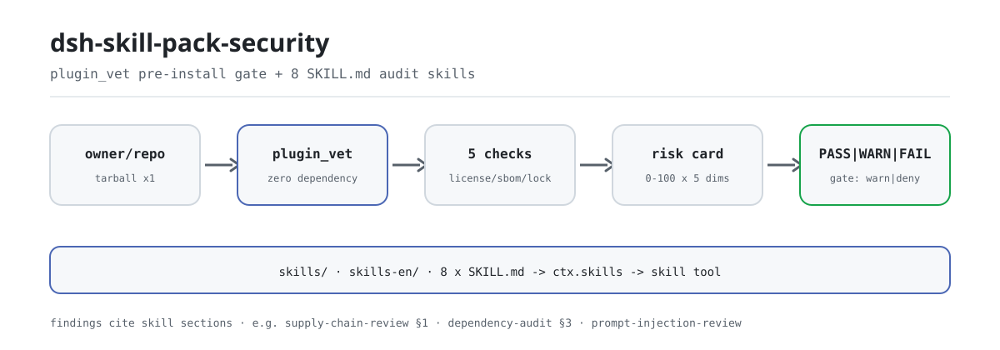
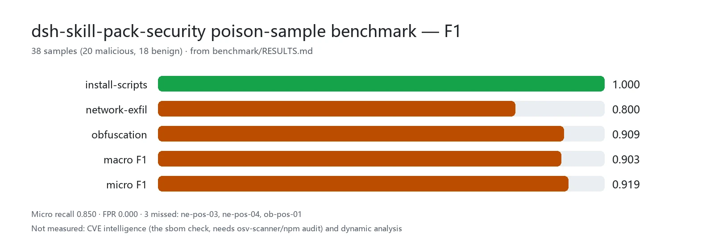

<div align="center">

<picture>
  <source media="(prefers-color-scheme: dark)" srcset="docs/assets/dsh-skill-pack-security-flow-dark.svg">
  
</picture>

# dsh-skill-pack-security

**Pon el riesgo de la cadena de suministro sobre la mesa antes de `dsh plugin add`: el veredicto, no la intuición, decide la instalación.**

Ocho skills de auditoría de seguridad más una puerta automática previa a la instalación para DeepSeek Harness: las skills enseñan la metodología, `plugin_vet` ejecuta las comprobaciones mecánicas y cada hallazgo remite a la sección de la skill correspondiente.

[Instalar](#instalación-en-tres-pasos) · [Configuración](#configuración) · [FAQ](#faq) · [简体中文](README.md) · [English](README.en.md) · [Español](README.es.md) · [Português](README.pt.md) · [हिन्दी](README.hi.md)

[](LICENSE)
[](#compatibilidad)
[](https://github.com/PerryLink/dsh-skill-pack-security/actions/workflows/verify.yml)
[](#compatibilidad)

[](https://github.com/PerryLink/dsh-skill-pack-security/stargazers)
[](https://dshfind.com/plugins/PerryLink/dsh-skill-pack-security?ref=badge)
[](https://securityscorecards.dev/viewer/?uri=github.com/PerryLink/dsh-skill-pack-security)
[](https://dsh.market/)
[](https://gitee.com/perrylink/dsh-skill-pack-security)

```sh
dsh plugin --profile <name> add dsh-skill-pack-security
```

</div>

<sub>Plugin de la comunidad, sin afiliación con DeepSeek. Repositorio canónico: <https://github.com/PerryLink/dsh-skill-pack-security> (Gitee es un espejo).</sub>

<sub>Este proyecto se ha trasladado a **[dsh-security-pack](https://github.com/PerryLink/dsh-security-pack)**: este repositorio queda como índice y copia de seguridad y el trabajo nuevo ocurre allí; el paquete npm antiguo `@perrylink/dsh-skill-pack-security-provider` está obsoleto.</sub>

## Qué es

`dsh-skill-pack-security` es un **paquete de skills más una puerta de cadena de suministro**. Ocho metodologías de seguridad se entregan como bundle `SKILL.md` que el modelo descubre en el catálogo de la sesión y carga bajo demanda, mientras `plugin_vet` ejecuta las comprobaciones mecánicas previas a la instalación — licencia, SBOM, bloqueo de commit, scripts de ciclo de vida y dominios de exfiltración, una tarjeta de riesgo de cinco dimensiones — y cierra con PASS / WARN / FAIL. Las skills responden "cómo audito esto"; la herramienta responde "cómo viene el paquete antes de instalarlo"; ambas comparten vocabulario y numeración de secciones. El paquete raíz es un manifiesto de bundle privado; el paquete ejecutable es `@perrylink/dsh-skill-pack-security-provider`.

```text
owner/repo ──tarball (1 vez)──▶ plugin_vet ──▶ license · sbom · commit-lock
                                               lifecycle · exfil · obfuscation
                                               data-responsibility
                                      │
                                      ▼
                 tarjeta de riesgo (5 dims x 0-100) ──▶ PASS | WARN | FAIL ──▶ gate.policy
```

## Instalación en tres pasos

1. **Instalar** (elige un canal; el paquete ejecutable es el provider):

   ```sh
   # canal git (último main)
   dsh plugin --profile web add github:PerryLink/dsh-skill-pack-security
   # canal npm (versiones publicadas, con provenance)
   dsh plugin --profile web add @perrylink/dsh-skill-pack-security-provider
   # canal tarball: tras pnpm pack dentro de provider/
   dsh plugin --profile web add ./@perrylink-dsh-skill-pack-security-provider-<version>.tgz
   ```

   `prepack` incrusta ambas ediciones — `skills/` (chino) y `skills-en/` (inglés) — en el tarball; la fila que se monta es la de `provider/cordis.patch.yml`.

2. **Configuración mínima** (por defecto publica la edición china; una clave la cambia):

   ```yaml
   - insert:
       - id: skill-pack-security
         name: '@perrylink/dsh-skill-pack-security-provider'
         config:
           language: en
   ```

3. **Comprobar que está activo**:

   ```sh
   dsh --profile web --dump-config | grep -A3 'id: skill-pack-security'
   ```

   Después pide al modelo cargar `security-audit` con la herramienta `skill` y llamar a `plugin_vet` una vez contra cualquier `owner/repo`: si devuelve la tarjeta de riesgo, funciona.

**Desinstalar**: `dsh plugin --profile web remove @perrylink/dsh-skill-pack-security-provider` (o elimina la fila; las copias de solo skills se borran con `-Uninstall` / `--uninstall` del instalador).

<details>
<summary>Instalar desde el mercado de DSH Desktop</summary>

Todos los plugins de PerryLink se pueden explorar en el mercado integrado de DSH Desktop: **Mercado → Fuentes → Añadir fuente → pegar** `https://perrylink-dsh-catalog.perrylink.workers.dev/catalog-source.json` **→ seleccionar**. La instalación sigue pasando por la verificación de identidad npm del mercado y por tu confirmación.

</details>

### Instalar las skills a mano

No hace falta el provider para usar las skills. El proveedor local de skills de DSH recorre cuatro raíces por rank (dentro de una capa gana el rank más bajo):

| Rank | Raíz | Alcance |
|---|---|---|
| 100 | `<projectRoot>/.dsh/skills` | De proyecto, viaja con el repositorio |
| 200 | `<projectRoot>/.agents/skills` | De proyecto, directorio compartido entre agentes |
| 400 | `<dshHome>/skills` (`$DSH_HOME` o `~/.dsh`) | De usuario, solo DSH |
| 500 | `<agentsHome>/skills` (`$DSH_AGENTS_HOME` o `~/.agents`) | De usuario, entre agentes |

Cadena de rank (gana el menor ante un nombre repetido en la capa): `project-dsh 100 < project-agents 200 < custom 300 < user-dsh 400 < user-agents 500`. El rank 300 es la capa registrada por plugins (como el `provider/` opcional de este paquete), no una raíz en disco.

```powershell
./scripts/install.ps1 -Target user-agents -Language zh   # Target: project-dsh | project-agents | user-dsh | user-agents; Language: zh (por defecto) | en
```

```sh
bash ./scripts/install.sh --target user-agents --language en
```

## Capacidades clave

- **Ocho skills, dos ediciones** — cada skill se entrega con nombres y metadatos idénticos en `skills/` (chino) y `skills-en/` (inglés); se instala un idioma por raíz.
- **Puerta `plugin_vet`** — escáner sin dependencias registrado en `ctx.tools` por el plugin opcional `provider/` (licencia / SBOM / bloqueo de commit / patrones maliciosos / revisión de responsabilidad de datos / tarjeta de riesgo de cinco dimensiones).
- **Los hallazgos citan las skills** — cada hallazgo apunta a la sección correspondiente (por ejemplo `supply-chain-review §1`) para que el agente siga la auditoría manual.
- **Ejecutable por un modelo** — cada paso de una skill es un comando real (`gitleaks`, `trivy`, `pnpm audit`, `npm view`, `git …`) con una muestra de salida esperada y un criterio de código de salida.

### Las ocho skills

| Skill | Propósito | Cuándo usarla |
|---|---|---|
| `security-audit` | Flujo de auditoría en cinco fases: alcance → inventario → clasificación de riesgo → verificación → plantilla de informe | Auditorías de repositorio completo, informes, planificación |
| `secret-scan` | Auditoría de credenciales: uso de gitleaks/trivy, niveles de falsos positivos, informes redactados, orden de remediación | Escaneo de secretos, triaje de alertas, informes de fuga |
| `dependency-audit` | Auditoría de cadena de suministro: lectura de pnpm/npm audit, licencias, riesgo de typosquat, deriva del lockfile | Revisión de dependencias, interpretación de informes de audit |
| `supply-chain-review` | Revisión rápida de PR/nueva dependencia: scripts de instalación peligrosos, typosquat, compilaciones reproducibles | Revisar PR que añaden dependencias |
| `prompt-injection-review` | Revisión de superficies de inyección en proyectos de agentes: AGENTS.md, skills, descripciones de herramientas, MCP, web | Revisar superficies de inyección del contexto del modelo |
| `threat-model` | Modelado de amenazas en diseño: fronteras de confianza, tabla STRIDE, árboles de ataque, mitigaciones | Modelar funciones nuevas, revisión de seguridad en diseño |
| `vuln-intel` | Inteligencia de vulnerabilidades: consultas NVD/CISA-KEV/GHSA/OSV con criterios de veredicto | Con un id CVE/GHSA, comprobar impacto y explotación |
| `incident-response` | Respuesta a incidentes en entornos de agentes: contener → evidencias → recuperar → postmortem | Incidentes de seguridad sospechados en DSH/agentes |

Cada bundle mantiene su archivo principal en ≤ 300 líneas (divulgación progresiva; el detalle vive en `references/`).

### plugin_vet — la puerta automática previa a la instalación

`plugin_vet` es el complemento automático del paquete: un escáner sin dependencias registrado en `ctx.tools` por el plugin `provider/`. Se le pasa un `owner/repo` de GitHub o una ruta de paquete local — descarga el tarball una vez (respetando el timeout y `AbortSignal`), escanea dentro de los límites de presupuesto y devuelve una tarjeta renderizada.

- **Escaneo de licencia** — localiza el archivo LICENSE y el campo `license`; `NOASSERTION`/`UNKNOWN`/`SEE LICENSE IN <file>`, un archivo ausente o un campo ausente se marcan; se reconocen los ids SPDX habituales.
- **SBOM** — extrae el árbol de dependencias con versiones del lockfile (pnpm/npm/yarn); cuando se detecta `osv-scanner` o `npm audit` en un objetivo local, su salida de vulnerabilidades sustituye al escaneo autocalculado y el informe anota la fuente (`builtin` / `osv-scanner` / `npm-audit`).
- **Bloqueo de commit** — las referencias del manifiesto de instalación y las actions del workflow deben ser SHA de commit inmutables de 40 hex; las referencias `@tag`/rama se marcan como mutables.
- **Patrones maliciosos** — scripts de ciclo de vida (`preinstall`/`install`/`postinstall`), dominios de exfiltración de red y cargas ofuscadas/codificadas en el código publicado.
- **Revisión de responsabilidad de datos** — las dimensiones del escaneo de políticas como reglas deterministas: listeners sin puerta en seams sensibles (`agent/pre-step`, `tools/pre-execute`, `session/event`, …), endpoints salientes sin divulgación de telemetría/privacidad en el README, cobertura de palabras clave descripción-comportamiento y cargas de anulación de instrucciones incrustadas en el texto publicado (skills, docs, prompts, tests). Cada hallazgo cita `prompt-injection-review` para la revisión manual; se desactiva por despliegue con `vet.dataResponsibility: false`. La etapa de revisión asistida por modelo es la mejora futura documentada.
- **Informe de riesgo de cinco dimensiones** — licencia / origen / dependencias / scripts de compilación / mantenimiento, cada una 0-100, resumidas en un veredicto global: PASS, WARN o FAIL.

**Puerta de instalación.** El veredicto alimenta una puerta de instalación — `gate.policy: warn` (por defecto, no bloqueante) imprime un aviso en FAIL; `gate.policy: deny` devuelve un veredicto de denegación. La herramienta no intercepta el `dsh plugin add` del host; hay que cablear el veredicto en el instalador/CI para hacerlo cumplir:

```yaml
- id: skill-pack-security
  name: '@perrylink/dsh-skill-pack-security-provider'
  config:
    language: en
    vet:
      gate:
        policy: deny   # devuelve un veredicto de denegación si plugin_vet falla (lo aplica quien llama)
```

**Complementa a `dsh-plugin-check`.** Las 36 comprobaciones del validador oficial verifican el *contrato y la calidad* del plugin (esquema de configuración, registro de effects, forma del JSON de herramientas); `plugin_vet` verifica la *cadena de suministro* de donde viene. Conviene ejecutar ambos:

| | `dsh-plugin-check` (36 comprobaciones) | `plugin_vet` (este repositorio) |
|---|---|---|
| Pregunta que responde | ¿Está bien formado y cumple el contrato? | ¿Es seguro instalar este paquete? |
| Qué mira | Código, esquema, registros, contratos de herramientas | LICENSE, lockfile, refs/actions de instalación, scripts de ciclo de vida, exfiltración/ofuscación, mantenimiento, responsabilidad de datos (alcance de hooks, divulgación de telemetría, descripción-comportamiento, cargas de inyección incrustadas) |
| Veredicto | Pass/fail por comprobación | PASS / WARN / FAIL + puerta |
| Cuándo | Durante el desarrollo o la revisión | Antes de `dsh plugin add`, en revisión de PR, en la puerta de CI |
| Bloqueo | Puerta de CI (distinto de cero ante violaciones) | Configurable: `warn` (por defecto) o `deny` |

### Por qué skills y no herramientas

| Forma | Qué hace | Qué no puede hacer |
|---|---|---|
| Plugin de herramientas (p. ej. escáneres) | *Ejecuta* escaneos y devuelve hallazgos | Interpretar alertas, clasificar falsos positivos, escribir informes redactados |
| Capa de protocolo | *Restringe* un protocolo | Generalizar entre repositorios y agentes |
| **Paquete de skills (este repositorio)** | *Enseña metodología*: triaje, informe, orden de remediación — **y** automatiza las comprobaciones estáticas previas con `plugin_vet` | Sustituir una auditoría manual de extremo a extremo |

Instalado junto a un plugin de seguridad de tipo herramienta, ambos se componen: la herramienta ejecuta el escaneo, la skill conduce la interpretación, el triaje y el informe. Este paquete reúne ambas formas: las skills enseñan la metodología y `plugin_vet` ejecuta el subconjunto estático mecánico, con cada hallazgo remitiendo a las skills.

Las más de 3000 skills del ecosistema Claude Code demuestran el valor de distribución de esta forma. El frontmatter `SKILL.md` de DSH (`name`, `description`, `whenToUse`) es compatible con el formato de las skills de CC; este paquete usa solo el subconjunto común y su contenido es enteramente original.

### Herramientas y superficies

| Superficie | Tipo | Notas |
|---|---|---|
| `plugin_vet` | tool | Escaneo de cadena de suministro previo (licencia / SBOM / bloqueo de commit / malicioso / tarjeta de riesgo); los hallazgos citan secciones de skills |
| `skill-pack-security` | skill provider | Registra la edición `skills/` o `skills-en/` del paquete en `ctx.skills` |
| Ocho bundles `SKILL.md` | skills | La metodología de auditoría, en dos ediciones de idioma |
| puerta de instalación | gate | `vet.gate.policy: warn \| deny` devuelve un veredicto; lo aplica quien llama (instalador/CI) |

## Datos medidos

<picture>
  <source media="(prefers-color-scheme: dark)" srcset="docs/assets/dsh-skill-pack-security-evidence-en-dark.webp">
  
</picture>

La tasa de detección, la tasa de falsos positivos y la F1 por clase sobre 38 muestras envenenadas (20 maliciosas, 18 benignas) se publican en [`benchmark/RESULTS.md`](benchmark/RESULTS.md); se regenera con `pnpm --dir provider run build && node benchmark/run.mjs` (sin dependencias nuevas). Lo medido son las tres comprobaciones de patrones maliciosos del motor publicado — `installScriptsCheck`, `networkExfilCheck`, `obfuscationCheck`; solo un veredicto `fail` (el estado que bloquea una instalación con la política `deny`) cuenta como detección, un `warn` no. Recall micro 0.850, F1 macro 0.903, F1 micro 0.919 y cero falsos positivos. Las tres muestras no detectadas y la brecha frente a OSV/Socket están escritas en RESULTS.md: estas heurísticas solo leen la forma y no llevan base de datos de vulnerabilidades, por lo que la inteligencia de CVE corresponde a la comprobación `sbom` (necesita `osv-scanner`/`npm audit`).

## Configuración

Todos los ajustes son campos Schemastery `Config` (modificables desde cordis.yml). `provider/cordis.patch.yml` documenta cada clave en línea.

Claves más usadas:

| Clave | Predeterminado | Significado |
|---|---|---|
| `language` | `zh` | Edición a publicar: `skills/` en chino o `skills-en/` en inglés; se ignora cuando `skillsDir` está definido |
| `skillsDir` | *(sin definir)* | Raíz de skills explícita; sustituye el valor derivado de `language` y debe contener bundles `<skill>/SKILL.md` |
| `vet.enable` | `true` | Registra la herramienta de puerta `plugin_vet` |
| `vet.dataResponsibility` | `true` | Ejecuta la revisión de responsabilidad de datos (se puede desactivar por despliegue) |
| `vet.externalScanners` | `true` | Orquesta `osv-scanner`/`npm audit` cuando sus CLI están presentes; `false` fuerza el escaneo de dependencias autocalculado |
| `vet.gate.policy` | `warn` | Puerta de instalación: `warn` (no bloqueante) o `deny` (bloquea en FAIL) |

<details>
<summary>Tabla de configuración completa (14 claves)</summary>

| Clave | Predeterminado | Significado |
|---|---|---|
| `language` | `zh` | Edición a publicar: `skills/` en chino o `skills-en/` en inglés; se ignora cuando `skillsDir` está definido |
| `watch` | `false` | Vigilar el directorio empaquetado de skills (contenido estático, por eso está desactivado) |
| `skillsDir` | *(sin definir)* | Raíz de skills explícita; sustituye el valor derivado de `language` y debe contener bundles `<skill>/SKILL.md` |
| `vet.enable` | `true` | Registra la herramienta de puerta `plugin_vet` |
| `vet.timeoutMs` | `15000` | Timeout de descarga del tarball en ms |
| `vet.maxFiles` | `800` | Límite de archivos escaneados |
| `vet.maxFileBytes` | `262144` | Límite de bytes por archivo |
| `vet.maxExtractBytes` | `67108864` | Límite de bytes extraídos |
| `vet.maxDepNodes` | `600` | Límite de nodos del árbol de dependencias |
| `vet.maxFindingsPerCheck` | `12` | Límite de hallazgos por comprobación |
| `vet.dataResponsibility` | `true` | Ejecuta la revisión de responsabilidad de datos (se puede desactivar por despliegue) |
| `vet.externalScanners` | `true` | Orquesta `osv-scanner`/`npm audit` cuando sus CLI están presentes; `false` fuerza el escaneo de dependencias autocalculado |
| `vet.userAgent` | `dsh-skill-pack-security/2.2.25 (+https://github.com/PerryLink/dsh-skill-pack-security)` | User-agent de descarga |
| `vet.gate.policy` | `warn` | Puerta de instalación: `warn` (no bloqueante) o `deny` (bloquea en FAIL) |

</details>

Ejemplo de anulación en el patch del perfil:

```yaml
- insert:
    - id: skill-pack-security
      name: '@perrylink/dsh-skill-pack-security-provider'
      config:
        language: zh
        vet:
          gate:
            policy: deny
```

## FAQ

<details>
<summary>¿A dónde van los datos escaneados? ¿Qué sale de mi máquina?</summary>

`plugin_vet` descarga el tarball objetivo una vez (respetando `vet.timeoutMs` y `AbortSignal`), lo extrae y lo escanea en local, y redacta el texto con forma de secreto en el informe renderizado; el plugin no inyecta secciones de prompt ni envía informes a ningún sitio. El manifiesto `dshWorkshop` declara exactamente dos permisos: `files:read` y `network:fetch`. Las skills son texto plano sin código ejecutable.

</details>

<details>
<summary>¿Qué pasa si falta una dependencia o una función del host? ¿Falla en silencio?</summary>

Nada es silencioso. Un `skillsDir` vacío o inexistente hace fallar al provider ruidosamente en el montaje; cuando faltan `osv-scanner`/`npm audit`, `vet.externalScanners` vuelve al escaneo autocalculado y anota la fuente en el informe; con `vet.enable: false` la herramienta `plugin_vet` simplemente no se registra (las skills siguen funcionando).

</details>

<details>
<summary>¿Compite con otros plugins de seguridad? ¿Sigue haciendo falta el dsh-plugin-check oficial?</summary>

No hay competencia: el plugin registra una herramienta (`plugin_vet`) y un conjunto de skills, y los nombres de las skills no se solapan con las oficiales ni con los paquetes comunitarios conocidos (ver «Interoperabilidad con otros plugins DSH»). Conviene seguir ejecutando el `dsh-plugin-check` oficial: cubre contrato y calidad, `plugin_vet` cubre la cadena de suministro; dos preguntas distintas, dos reglas distintas.

</details>

<details>
<summary>¿Cuánta sobrecarga de rendimiento supone?</summary>

Las comprobaciones son heurísticas estáticas — sin dependencias, sin ejecución dinámica —, así que el coste es una descarga de tarball más la extracción; cuatro límites de presupuesto (`vet.maxFiles` 800, `vet.maxFileBytes` 262144, `vet.maxExtractBytes` 67108864, `vet.maxDepNodes` 600) y un timeout de 15 segundos acotan el peor caso. Para la precisión medida, ver «Datos medidos» (38 muestras, F1 micro 0.919).

</details>

## Límites de seguridad

- **Motor sin dependencias.** `plugin_vet` usa solo builtins `node:` e importaciones relativas.
- **Puerta previa de alcance estrecho.** No es una herramienta de auditoría de seguridad general — es deliberadamente complementaria a los plugins escáner y al validador de contrato oficial `dsh-plugin-check`.
- **No bloqueante por defecto.** La puerta de instalación es `warn` salvo que se opte por `deny`.
- **Contenido original.** Compatible con el formato de skills de Claude Code, pero sin copiar contenido de skills CC y sin mercado de skills.
- **Motor original, sin ports de terceros.** El escaneo de licencias y las comprobaciones de patrones maliciosos son implementaciones originales sin dependencias; los activos GPL-Radar / LLM-detective / Sus-PY se evaluaron para portarlos pero no se encontró fuente pública con licencia verificable — ver `THIRD_PARTY_NOTICES.md`.

## Permisos y datos

- **Permisos**: el manifiesto `dshWorkshop` declara `files:read` y `network:fetch`.
- **Datos**: `plugin_vet` descarga un tarball una vez (respetando el timeout y `AbortSignal`) y el informe redacta el texto con forma de secreto; el plugin no inyecta secciones de prompt.
- **Registro de sesión**: este plugin no declara ningún tipo de evento de sesión, así que el rastro de auditoría queda en los eventos `tool/call` + `tool/result` del host.

## Limitaciones conocidas

- **No es una herramienta de auditoría completa.** `plugin_vet` es una puerta de confianza previa de alcance estrecho; no sustituye una auditoría manual de extremo a extremo.
- **Solo escaneo estático.** Las señales de patrones maliciosos y de mantenimiento son heurísticas sobre el paquete publicado, no análisis dinámico.
- **Una edición por raíz.** Las skills con el mismo nombre en una raíz se resuelven por rank, así que solo una edición de idioma entra en el catálogo de la sesión.

## Interoperabilidad con otros plugins DSH

Este plugin toca exactamente dos seams: registra `plugin_vet` en `ctx.tools` y la edición del paquete en `ctx.skills`. No compite por ningún nombre existente y se compone con los plugins de seguridad de tipo herramienta.

- **Cero colisiones de nombres de skills.** Los ocho nombres se comprobaron uno a uno contra el conjunto oficial `.agents/skills/` (12 skills, instantánea de 2026-08) y los paquetes comunitarios conocidos (`dsh-write-plugin`, `dsh-test-plugin`, `dsh-plugin-dev`, `make-dsh-plugin`, `find-plugins`, `mainline-compat`), sin solapamiento; `dhicoc/dsh-reverse-skill` (85 skills) y `cyzlmh/dsh-cyber-sec` (21 skills) tampoco tienen skills con esos nombres. Método y resultados por consulta: [`docs/ecosystem-conflict-check.md`](docs/ecosystem-conflict-check.md) (instantánea de 2026-08-14); `verify/verify-skill-pack.mts` lo comprueba mecánicamente en la comprobación 2.
- **Complementario a plugins de seguridad de tipo herramienta y protocolo.** Las formas existentes en este tema son «herramienta» y «protocolo»; este paquete es «skills más una puerta estática». La herramienta ejecuta el escaneo, las skills conducen la interpretación, el triaje y el informe — superficies distintas, sin competencia.
- **Complementario al `dsh-plugin-check` oficial.** 36 comprobaciones de contrato frente a una comprobación de cadena de suministro; la tabla comparativa está en «Capacidades clave».
- **El bundle solo inserta su propia fila.** `provider/cordis.patch.yml` hace `insert` de exactamente una fila `skill-pack-security` y nunca sobrescribe el `config` de una fila integrada.

## Compatibilidad

| Superficie | Estado |
|---|---|
| Harness | DeepSeek Harness **`dsh-v0.2.1-alpha.1`** (tag de GitHub, verificado 2026-09-25: cadena de puertas completa + instalación de perfil de humo). Línea de dependencia npm: `@deepseek-ai/dsh` **0.1.5-rc.2** (peers `>=0.1.2-rc.1 <0.2.0 \|\| >=0.1.5-alpha.1 <0.2.0`). El sobre de sesión conserva su campo ignorable solo por compatibilidad de lectura de logs guardados: Session.append sigue sin poder estamparlo, así que el comportamiento de la puerta de auditoría no cambia. |
| Node | `^22.19.0 \|\| >=24.0.0` (el runtime de DeepSeek Harness) |
| Plataformas | Todas (las skills son contenido; el provider es un plugin de host). CI ejecuta las 25 comprobaciones en Ubuntu y en Windows |
| Modelo | Cualquiera (las skills se cargan bajo demanda con la herramienta `skill`; `plugin_vet` es determinista) |

## Ecosistema y calidad

- [Espejo en Gitee](https://gitee.com/perrylink/dsh-skill-pack-security) (espejo sincronizado; GitHub es el canónico)
- [Página del plugin en dshfind](https://dshfind.com/plugins/PerryLink/dsh-skill-pack-security) (instalaciones y ranking)
- [Informe OpenSSF Scorecard](https://securityscorecards.dev/viewer/?uri=github.com/PerryLink/dsh-skill-pack-security) (impulsado por [.github/workflows/scorecard.yml](.github/workflows/scorecard.yml))
- [Auditoría estática de dsh-plugin-doctor](.github/workflows/plugin-doctor.yml) (ejecuta los criterios R+K de la SPEC en cada push/PR)
- [DSH Market](https://dsh.market/) (listado)
- **Canal de la tienda 1024**: `npm i -g dsh1024` una vez y luego `dsh1024 plugin --profile web add dsh-skill-pack-security` (cuenta para el ranking de instalaciones de [deepseek1024.com](https://deepseek1024.com))
- [Base de conocimiento del ecosistema](https://perrylink.github.io/dsh-plugin-guide/) — datos medidos, no marketing: guía de desarrollo de plugins · datos de selección · criterios de mantenimiento

### Hoja de ruta

- `dsh-skill-pack-data-engineering` — pipelines de datos, calidad de datos, listas de comprobación ETL (misma plantilla)
- `dsh-skill-pack-oss-collab` — etiqueta de PR, triaje de issues, flujos de mantenedores
- `dsh-skill-pack-performance` — metodología de profiling, criterios de benchmark, listas de regresión
- Más skills dentro de este paquete (mismo límite de solo skills): `sbom-lifecycle` (generación, envejecimiento e importación de SBOM), `pen-test-review` (alcance de pruebas autorizadas y revisión de informes), `compliance-audit` (recorridos ASVS/NIST-CSF)
- Mantener frescos los artefactos de demo de `plugin_vet` (`docs/demos/run-demos.mjs`) y precisa la tabla de complemento de `dsh-plugin-check` a medida que el validador oficial añade comprobaciones

## Desarrollo

```sh
pnpm --dir provider run typecheck   # tsc --noEmit
pnpm --dir provider run build       # tsc --noEmitOnError
pnpm --dir provider run prepack     # incrusta ambas ediciones de skills en el tarball
tsx verify/verify-skill-pack.mts    # verificación headless de 25 comprobaciones
node benchmark/run.mjs              # conjunto de regresión de muestras envenenadas (build primero)
pnpm run check:readmes              # consistencia de los README en cinco idiomas
```

El diagrama de portada y el gráfico de datos medidos se generan programáticamente con [`scripts/gen-readme-assets.py`](scripts/gen-readme-assets.py) (Python + Pillow) y se pueden volver a ejecutar: `python scripts/gen-readme-assets.py`.

### Verificación: 25 comprobaciones headless

`verify/verify-skill-pack.mts` importa el parser **oficial** `dsh-skill-filesystem`, la herramienta `skill` **real** y el runtime de herramientas **real** desde un checkout local de `deepseek-harness`, y verifica 25 comprobaciones sobre ambas ediciones de idioma:

1. Estructura: ambas ediciones presentes, 8 bundles de directorio cada una, sin skills planas sueltas, el `name` del frontmatter coincide con el directorio, ≤ 300 líneas, `references/` cableado, `metadata.version` sincronizado con el archivo `VERSION`
2. Sin conflictos de nombre con las skills oficiales de `.agents/skills/` (derivadas del checkout en tiempo de ejecución) ni con paquetes comunitarios conocidos
3–6. Por edición (`skills/` china, `skills-en/` inglesa): descubrimiento en el registro mediante el provider oficial, carga completa con `ctx.skills.get()`, la herramienta `skill` real devolviendo `<skill_content>` (nombres desconocidos o inválidos rechazados) y el catálogo de sesión conteniendo solo `name` + `description` — `whenToUse` se queda fuera del catálogo del modelo (diseño oficial)
7. 13 fixtures de frontmatter incorrecto ejercitan las reglas fail-closed oficiales (campos ausentes, claves camel-case heredadas, valores no booleanos, nombres no kebab, directorios anidados, nombre desajustado); las skills en archivo plano cargan y `**/SKILL.md` anidado no se descubre
8. El plugin provider opcional monta la edición china y la inglesa vía `ctx.effect()`, se destruye limpiamente y rechaza configuraciones erróneas (`skillsDir` vacío o inexistente)
9–15. Comprobaciones de autoendurecimiento: paridad estructural zh↔en, cableado de references (sin archivos colgantes ni huérfanos), sincronía de versión del provider, ranks documentados frente a las constantes oficiales, patrones `grep -E` portables a POSIX, autocomprobación de secretos, release-checklist segura en UTF-8
16–19. `plugin_vet` por el runtime de herramientas real: se registra en `ctx.tools`; el fixture conforme pasa; el fixture sin licencia falla y cita `dependency-audit §3`; el fixture con postinstall malicioso falla (scripts/exfiltración/ofuscación, citando `supply-chain-review §1`); la puerta devuelve un veredicto de denegación con `policy: deny` (lo aplica quien llama)
20. El motor de escaneo no tiene dependencias (solo builtins `node:` e importaciones relativas)
21. La redacción del informe mantiene el texto con forma de secreto fuera de la salida renderizada

```powershell
# local: resuelve automáticamente el checkout del harness junto al paquete, o indícalo explícitamente
$env:DSH_HARNESS_CHECKOUT = 'D:\deepseek-harness'
& D:\deepseek-harness\node_modules\.bin\tsx.CMD verify\verify-skill-pack.mts
# All 25 checks passed for dsh-skill-pack-security.
```

Las mismas 25 comprobaciones se ejecutan en GitHub en cada push mediante `.github/workflows/verify.yml` — en Ubuntu y Windows —, además de un ejercicio de `install.sh`/`install.ps1` y un humo de compilación/empaquetado del provider que verifica que el tarball lleva ambas ediciones incrustadas y el patch del bundle.

### Estructura del repositorio

| Ruta | Qué es |
|---|---|
| `skills/<name>/SKILL.md` | Las ocho skills (edición china); el frontmatter sigue el contrato oficial `dsh-skill-filesystem` |
| `skills-en/<name>/SKILL.md` | Las ocho skills (edición inglesa); mismos nombres y metadatos que la china |
| `skills/<name>/references/` | Detalle de divulgación progresiva: matrices de comandos, tablas de triaje, plantillas |
| `scripts/install.ps1` | Instalador Windows de un comando para las cuatro raíces (ambas ediciones); registra un manifiesto, admite `-Uninstall`/`-DryRun`/`-Force` |
| `scripts/install.sh` | El equivalente POSIX (`--uninstall`/`--dry-run`/`--force`) |
| `provider/` | Bundle provider instalable por npm (declara `dsh.bundle`; incrusta ambas ediciones en `pack/` vía `prepack`; `language: zh\|en`); registra el proveedor de skills Y la herramienta de puerta `plugin_vet` vía `ctx.effect()`, y falla ruidosamente con un `skillsDir` erróneo |
| `provider/src/vet/` | El motor de escaneo `plugin_vet` sin dependencias (licencia / SBOM / bloqueo de commit / patrones maliciosos / informe de riesgo) |
| `package.json` | Manifiesto del bundle raíz: declara `dsh.bundle.patch` (→ `provider/cordis.patch.yml`) y los hechos de intake de `dshWorkshop` |
| `verify/verify-skill-pack.mts` | Verificación headless contra el parser oficial, la herramienta `skill` real y el runtime de herramientas real — 25 comprobaciones en ambas ediciones |
| `VERSION` | Fuente única de versión; cada `metadata.version` de SKILL.md y `provider/package.json` deben coincidir (lo impone CI) |
| `benchmark/` | El conjunto de regresión de muestras envenenadas (`dataset/poison.json`, `run.mjs`, `RESULTS.md`) |
| `docs/` | Comprobación de conflictos del ecosistema, lista de release, planes de mejora y las demos de `plugin_vet` (`docs/demos/`) |
| `CHANGELOG.md` / `SECURITY.md` / `CONTRIBUTING.md` | Historial de versiones, política de reporte de vulnerabilidades y reglas de contribución/verificación |
| `.github/workflows/verify.yml` | CI: 25 comprobaciones + ejercicio del instalador + humo de compilación/empaquetado del provider (Ubuntu y Windows) |
| `.github/dependabot.yml` | Actualizaciones semanales de dependencias del provider y de GitHub Actions |
| `LICENSE` | Apache License 2.0 |
| `THIRD_PARTY_NOTICES.md` | Postura de terceros: motor sin dependencias, activos evaluados pero no portados, licencias de las peer dependencies |

## Familia y agradecimientos

Este proyecto forma parte de la familia de plugins de DeepSeek Harness de [PerryLink](https://github.com/PerryLink) (todos Apache-2.0). Si te resulta útil, **una estrella ayuda a que la siguiente persona lo encuentre** — no desbloquea nada.

- [@PerryLink](https://github.com/PerryLink) — autor y mantenedor: las ocho skills en ambos idiomas, los instaladores, la suite de verificación, el bundle provider, CI y la documentación.

<details>
<summary>Desplegar los 95 plugins</summary>

| Plugin | Estado |
|---|---|
| **[dsh-aqua-input-check](https://github.com/PerryLink/dsh-aqua-input-check)** |  |
| **[dsh-archive-check](https://github.com/PerryLink/dsh-archive-check)** |  |
| **[dsh-auto-review](https://github.com/PerryLink/dsh-auto-review)** |  |
| **[dsh-autotier](https://github.com/PerryLink/dsh-autotier)** | 🧊 CONGELADO — ver el README del repo |
| **[dsh-background-agents](https://github.com/PerryLink/dsh-background-agents)** | 🚫 RETIRADO (repo archivado) |
| **[dsh-bid-ca-precheck](https://github.com/PerryLink/dsh-bid-ca-precheck)** |  |
| **[dsh-bid-qual-check](https://github.com/PerryLink/dsh-bid-qual-check)** |  |
| **[dsh-budget](https://github.com/PerryLink/dsh-budget)** | 🧊 CONGELADO — ver el README del repo |
| **[dsh-cert-mcp](https://github.com/PerryLink/dsh-cert-mcp)** | 🧊 CONGELADO — ver el README del repo |
| **[dsh-checkpoint-rewind](https://github.com/PerryLink/dsh-checkpoint-rewind)** |  |
| **[dsh-claude-move](https://github.com/PerryLink/dsh-claude-move)** | 🧊 CONGELADO — ver el README del repo |
| **[dsh-click](https://github.com/PerryLink/dsh-click)** |  |
| **[dsh-composer-history](https://github.com/PerryLink/dsh-composer-history)** |  |
| **[dsh-contract-stance](https://github.com/PerryLink/dsh-contract-stance)** |  |
| **[dsh-customs-doc-check](https://github.com/PerryLink/dsh-customs-doc-check)** |  |
| **[dsh-data-quality](https://github.com/PerryLink/dsh-data-quality)** | 🧊 CONGELADO — ver el README del repo |
| **[dsh-defend](https://github.com/PerryLink/dsh-defend)** | 🧊 CONGELADO — ver el README del repo |
| **[dsh-demurrage-ledger](https://github.com/PerryLink/dsh-demurrage-ledger)** |  |
| **[dsh-doublecheck](https://github.com/PerryLink/dsh-doublecheck)** |  |
| **[dsh-draw](https://github.com/PerryLink/dsh-draw)** | 🧊 CONGELADO — ver el README del repo |
| **[dsh-drill-script-check](https://github.com/PerryLink/dsh-drill-script-check)** |  |
| **[dsh-eia-guide-check](https://github.com/PerryLink/dsh-eia-guide-check)** |  |
| **[dsh-emergency-plan](https://github.com/PerryLink/dsh-emergency-plan)** |  |
| **[dsh-essay-rubric-check](https://github.com/PerryLink/dsh-essay-rubric-check)** |  |
| **[dsh-evidence-check](https://github.com/PerryLink/dsh-evidence-check)** |  |
| **[dsh-export-ctl-check](https://github.com/PerryLink/dsh-export-ctl-check)** |  |
| **[dsh-fast](https://github.com/PerryLink/dsh-fast)** |  |
| **[dsh-fmea-table-check](https://github.com/PerryLink/dsh-fmea-table-check)** |  |
| **[dsh-forecast-penalty](https://github.com/PerryLink/dsh-forecast-penalty)** |  |
| **[dsh-fund-research](https://github.com/PerryLink/dsh-fund-research)** |  |
| **[dsh-github](https://github.com/PerryLink/dsh-github)** |  |
| **[dsh-gongwen-flow-check](https://github.com/PerryLink/dsh-gongwen-flow-check)** |  |
| **[dsh-gongwen-word-check](https://github.com/PerryLink/dsh-gongwen-word-check)** |  |
| **[dsh-guard-plan-qc](https://github.com/PerryLink/dsh-guard-plan-qc)** |  |
| **[dsh-hazchem-check](https://github.com/PerryLink/dsh-hazchem-check)** |  |
| **[dsh-hazplan-check](https://github.com/PerryLink/dsh-hazplan-check)** |  |
| **[dsh-hidden-risk-map](https://github.com/PerryLink/dsh-hidden-risk-map)** |  |
| **[dsh-hs-classify](https://github.com/PerryLink/dsh-hs-classify)** |  |
| **[dsh-icd-rule-check](https://github.com/PerryLink/dsh-icd-rule-check)** |  |
| **[dsh-industry-research](https://github.com/PerryLink/dsh-industry-research)** |  |
| **[dsh-lawcite-adapter](https://github.com/PerryLink/dsh-lawcite-adapter)** |  |
| **[dsh-laya](https://github.com/PerryLink/dsh-laya)** |  |
| **[dsh-lc-doc-check](https://github.com/PerryLink/dsh-lc-doc-check)** |  |
| **[dsh-learning-gap-check](https://github.com/PerryLink/dsh-learning-gap-check)** |  |
| **[dsh-library](https://github.com/PerryLink/dsh-library)** |  |
| **[dsh-local-ai](https://github.com/PerryLink/dsh-local-ai)** |  |
| **[dsh-lsp-actions](https://github.com/PerryLink/dsh-lsp-actions)** |  |
| **[dsh-mask](https://github.com/PerryLink/dsh-mask)** |  |
| **[dsh-mcp-panel](https://github.com/PerryLink/dsh-mcp-panel)** |  |
| **[dsh-medrec-qc](https://github.com/PerryLink/dsh-medrec-qc)** |  |
| **[dsh-memento](https://github.com/PerryLink/dsh-memento)** | 🧊 CONGELADO — ver el README del repo |
| **[dsh-nsfc-form-check](https://github.com/PerryLink/dsh-nsfc-form-check)** |  |
| **[dsh-nurse-record-check](https://github.com/PerryLink/dsh-nurse-record-check)** |  |
| **[dsh-observe](https://github.com/PerryLink/dsh-observe)** |  |
| **[dsh-origin-rvc-check](https://github.com/PerryLink/dsh-origin-rvc-check)** |  |
| **[dsh-ota-review-check](https://github.com/PerryLink/dsh-ota-review-check)** |  |
| **[dsh-output-styles](https://github.com/PerryLink/dsh-output-styles)** |  |
| **[dsh-paper-doc-adapter](https://github.com/PerryLink/dsh-paper-doc-adapter)** |  |
| **[dsh-permission-rules](https://github.com/PerryLink/dsh-permission-rules)** |  |
| **[dsh-permit-report-check](https://github.com/PerryLink/dsh-permit-report-check)** |  |
| **[dsh-pipeline-check](https://github.com/PerryLink/dsh-pipeline-check)** |  |
| **[dsh-pleading-draft](https://github.com/PerryLink/dsh-pleading-draft)** |  |
| **[dsh-plugin-doctor](https://github.com/PerryLink/dsh-plugin-doctor)** | 🚫 RETIRADO (repo archivado) |
| **[dsh-plugin-guide](https://github.com/PerryLink/dsh-plugin-guide)** |  |
| **[dsh-plugin-kit](https://github.com/PerryLink/dsh-plugin-kit)** | 🚫 RETIRADO (repo archivado) |
| **[dsh-plugin-upgrade](https://github.com/PerryLink/dsh-plugin-upgrade)** | 🚫 RETIRADO (repo archivado) |
| **[dsh-policy-brief-draft](https://github.com/PerryLink/dsh-policy-brief-draft)** |  |
| **[dsh-power-loss-split](https://github.com/PerryLink/dsh-power-loss-split)** |  |
| **[dsh-power-ticket-check](https://github.com/PerryLink/dsh-power-ticket-check)** |  |
| **[dsh-ppap-check](https://github.com/PerryLink/dsh-ppap-check)** |  |
| **[dsh-protest-deadline](https://github.com/PerryLink/dsh-protest-deadline)** |  |
| **[dsh-railway-window](https://github.com/PerryLink/dsh-railway-window)** |  |
| **[dsh-reach](https://github.com/PerryLink/dsh-reach)** | 🧊 CONGELADO — ver el README del repo |
| **[dsh-repair-order-qc](https://github.com/PerryLink/dsh-repair-order-qc)** |  |
| **[dsh-research-report](https://github.com/PerryLink/dsh-research-report)** |  |
| **[dsh-review-reply-check](https://github.com/PerryLink/dsh-review-reply-check)** |  |
| **[dsh-rulefile-check](https://github.com/PerryLink/dsh-rulefile-check)** |  |
| **[dsh-safety-brief-check](https://github.com/PerryLink/dsh-safety-brief-check)** |  |
| **[dsh-score](https://github.com/PerryLink/dsh-score)** | 🧊 CONGELADO — ver el README del repo |
| **[dsh-session-pin](https://github.com/PerryLink/dsh-session-pin)** | 🚫 RETIRADO (repo archivado) |
| **[dsh-session-sync](https://github.com/PerryLink/dsh-session-sync)** |  |
| **[dsh-site-log-check](https://github.com/PerryLink/dsh-site-log-check)** |  |
| **[dsh-skill-pack-security](https://github.com/PerryLink/dsh-skill-pack-security)** |  |
| **[dsh-soe-decision-check](https://github.com/PerryLink/dsh-soe-decision-check)** |  |
| **[dsh-soilwater-check](https://github.com/PerryLink/dsh-soilwater-check)** |  |
| **[dsh-sop-sync-check](https://github.com/PerryLink/dsh-sop-sync-check)** |  |
| **[dsh-spc-gbt-adapter](https://github.com/PerryLink/dsh-spc-gbt-adapter)** |  |
| **[dsh-talk](https://github.com/PerryLink/dsh-talk)** |  |
| **[dsh-team-rooms](https://github.com/PerryLink/dsh-team-rooms)** | 🚫 RETIRADO (repo archivado) |
| **[dsh-tender-extract](https://github.com/PerryLink/dsh-tender-extract)** |  |
| **[dsh-tender-matrix](https://github.com/PerryLink/dsh-tender-matrix)** |  |
| **[dsh-test-drive](https://github.com/PerryLink/dsh-test-drive)** |  |
| **[dsh-ticktick](https://github.com/PerryLink/dsh-ticktick)** | 🚫 RETIRADO (repo archivado) |
| **[dsh-translate](https://github.com/PerryLink/dsh-translate)** |  |
| **[dsh-warranty-calc](https://github.com/PerryLink/dsh-warranty-calc)** |  |

</details>

## Licencia

[LICENSE](LICENSE) (Apache License 2.0) © 2026 dsh-skill-pack-security contributors

<p align="center"><sub>Apache-2.0 · Plugin de la comunidad, no afiliado a DeepSeek.</sub></p>
