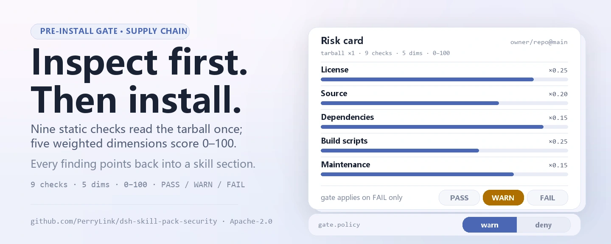
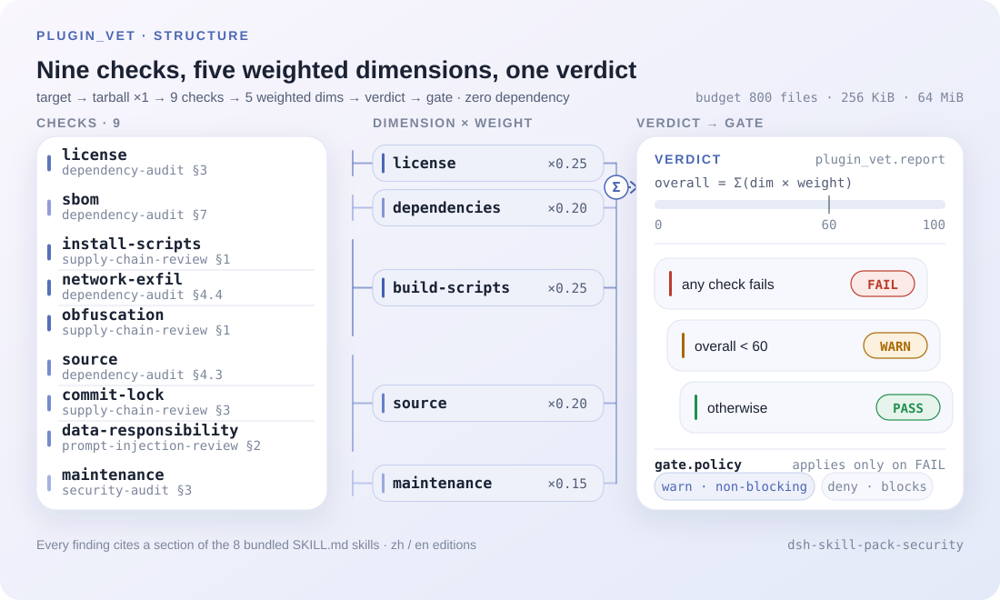
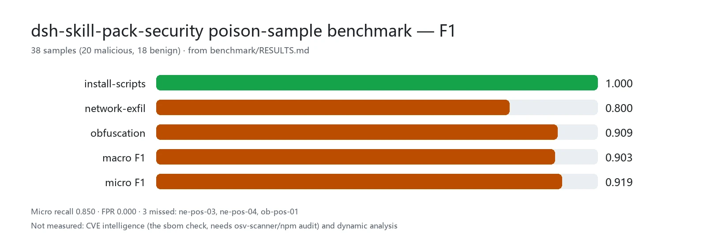

<div align="center">

<picture>
  <source media="(prefers-color-scheme: dark)" srcset="docs/assets/dsh-skill-pack-security-hero-en-dark.webp">
  
</picture>

# dsh-skill-pack-security

**`dsh plugin add` से पहले सप्लाई-चेन जोखिम सामने रखें — इंस्टॉल का फ़ैसला नतीजा करता है, अंदाज़ा नहीं।**

DeepSeek Harness के लिए आठ सुरक्षा-ऑडिट स्किल्स और एक स्वचालित प्री-इंस्टॉल गेट: स्किल्स तरीका सिखाती हैं, `plugin_vet` यांत्रिक जाँच चलाता है, और हर निष्कर्ष संबंधित स्किल अनुभाग की ओर इशारा करता है।

[इंस्टॉल](#तीन-चरणों-में-शुरुआत) · [कॉन्फ़िगरेशन](#कॉन्फ़िगरेशन) · [FAQ](#faq) · [简体中文](README.md) · [English](README.en.md) · [Español](README.es.md) · [Português](README.pt.md) · [हिन्दी](README.hi.md)

[](LICENSE)
[](#संगतता)
[](https://github.com/PerryLink/dsh-skill-pack-security/actions/workflows/verify.yml)
[](#संगतता)

[](https://github.com/PerryLink/dsh-skill-pack-security/stargazers)
[](https://dshfind.com/plugins/PerryLink/dsh-skill-pack-security?ref=badge)
[](https://securityscorecards.dev/viewer/?uri=github.com/PerryLink/dsh-skill-pack-security)
[](https://dsh.market/)
[](https://gitee.com/perrylink/dsh-skill-pack-security)

```sh
dsh plugin --profile <name> add dsh-skill-pack-security
```

</div>

<sub>समुदाय प्लगइन, DeepSeek से कोई आधिकारिक संबंध नहीं। मुख्य रेपो: <https://github.com/PerryLink/dsh-skill-pack-security> (Gitee मिरर है)।</sub>

<sub>यह प्रोजेक्ट **[dsh-security-pack](https://github.com/PerryLink/dsh-security-pack)** में स्थानांतरित हो गया है: यह रेपो सूचक/बैकअप के रूप में रहता है और नया काम वहाँ होता है; पुराना npm पैकेज `@perrylink/dsh-skill-pack-security-provider` अप्रचलित है।</sub>

## यह क्या है

`dsh-skill-pack-security` एक **स्किल पैक और सप्लाई-चेन गेट** है। आठ सुरक्षा पद्धतियाँ `SKILL.md` बंडल के रूप में आती हैं जिन्हें मॉडल सेशन कैटलॉग में खोजता है और माँगने पर `skill` टूल से लोड करता है; वहीं `plugin_vet` प्री-इंस्टॉल यांत्रिक जाँचें चलाता है — लाइसेंस, SBOM, commit लॉक, लाइफ़साइकल स्क्रिप्ट और exfil डोमेन, पाँच-आयाम जोखिम कार्ड — और अंत में PASS / WARN / FAIL देता है। स्किल्स बताती हैं "ऑडिट कैसे करें", टूल बताता है "इंस्टॉल से पहले पैकेज कैसा दिखता है"; दोनों एक ही शब्दावली और अनुभाग-क्रमांक साझा करते हैं। रूट पैकेज निजी बंडल मैनिफ़ेस्ट है; चलने वाला पैकेज `@perrylink/dsh-skill-pack-security-provider` है।

```text
owner/repo ──tarball (1 बार)──▶ plugin_vet ──▶ license · sbom · commit-lock
                                               lifecycle · exfil · obfuscation
                                               data-responsibility
                                      │
                                      ▼
                 जोखिम कार्ड (5 आयाम x 0-100) ──▶ PASS | WARN | FAIL ──▶ gate.policy
```

<picture>
  <source media="(prefers-color-scheme: dark)" srcset="docs/assets/dsh-skill-pack-security-flow-v5-dark.svg">
  
</picture>

## तीन चरणों में शुरुआत

1. **इंस्टॉल** (कोई एक चैनल; चलने वाला पैकेज provider है):

   ```sh
   # git चैनल (नवीनतम main)
   dsh plugin --profile web add github:PerryLink/dsh-skill-pack-security
   # npm चैनल (प्रकाशित संस्करण, provenance के साथ)
   dsh plugin --profile web add @perrylink/dsh-skill-pack-security-provider
   # tarball चैनल: provider/ में pnpm pack के बाद
   dsh plugin --profile web add ./@perrylink-dsh-skill-pack-security-provider-<version>.tgz
   ```

   `prepack` दोनों संस्करण — `skills/` (चीनी) और `skills-en/` (अंग्रेज़ी) — tarball में एम्बेड करता है; माउंट होने वाली पंक्ति `provider/cordis.patch.yml` की है।

2. **न्यूनतम कॉन्फ़िगरेशन** (डिफ़ॉल्ट रूप से चीनी संस्करण; एक कुंजी बदलें):

   ```yaml
   - insert:
       - id: skill-pack-security
         name: '@perrylink/dsh-skill-pack-security-provider'
         config:
           language: en
   ```

3. **जाँचें कि लग गया**:

   ```sh
   dsh --profile web --dump-config | grep -A3 'id: skill-pack-security'
   ```

   फिर मॉडल से कहें कि `skill` टूल से `security-audit` लोड करे और किसी भी `owner/repo` पर एक बार `plugin_vet` चलाए — जोखिम कार्ड मिला तो काम कर रहा है।

**अनइंस्टॉल**: `dsh plugin --profile web remove @perrylink/dsh-skill-pack-security-provider` (या वह पंक्ति हटा दें; केवल-स्किल प्रतियाँ इंस्टॉलर के `-Uninstall` / `--uninstall` से हटती हैं)।

<details>
<summary>DSH Desktop मार्केट से इंस्टॉल</summary>

सभी PerryLink प्लगइन DSH Desktop के अंतर्निहित मार्केट में देखे जा सकते हैं: **मार्केट → स्रोत → स्रोत जोड़ें → चिपकाएँ** `https://perrylink-dsh-catalog.perrylink.workers.dev/catalog-source.json` **→ चुनें**। इंस्टॉल फिर भी मार्केट के npm पहचान सत्यापन और आपकी पुष्टि से गुज़रता है।

</details>

### स्किल्स हाथ से इंस्टॉल करना

स्किल्स उपयोग करने के लिए provider ज़रूरी नहीं। DSH का स्थानीय स्किल प्रोवाइडर चार रूट्स को rank के अनुसार स्कैन करता है (एक परत में समान नाम पर कम rank जीतता है):

| Rank | रूट | दायरा |
|---|---|---|
| 100 | `<projectRoot>/.dsh/skills` | प्रोजेक्ट-स्तरीय, रेपो के साथ चलता है |
| 200 | `<projectRoot>/.agents/skills` | प्रोजेक्ट-स्तरीय, साझा एजेंट निर्देशिका |
| 400 | `<dshHome>/skills` (`$DSH_HOME` या `~/.dsh`) | उपयोगकर्ता-स्तरीय, केवल DSH |
| 500 | `<agentsHome>/skills` (`$DSH_AGENTS_HOME` या `~/.agents`) | उपयोगकर्ता-स्तरीय, एजेंटों के बीच साझा |

Rank श्रृंखला (एक परत में समान नाम पर छोटा जीतता है): `project-dsh 100 < project-agents 200 < custom 300 < user-dsh 400 < user-agents 500`. custom 300 प्लगइन-पंजीकृत परत है (जैसे इस पैक का वैकल्पिक `provider/`), डिस्क रूट नहीं।

```powershell
./scripts/install.ps1 -Target user-agents -Language zh   # Target: project-dsh | project-agents | user-dsh | user-agents; Language: zh (डिफ़ॉल्ट) | en
```

```sh
bash ./scripts/install.sh --target user-agents --language en
```

## मुख्य क्षमताएँ

- **आठ स्किल्स, दो संस्करण** — हर स्किल `skills/` (चीनी) और `skills-en/` (अंग्रेज़ी) में समान नाम और मेटाडेटा के साथ आती है; प्रति रूट एक भाषा इंस्टॉल करें।
- **`plugin_vet` गेट** — वैकल्पिक `provider/` प्लगइन द्वारा `ctx.tools` पर पंजीकृत शून्य-निर्भरता स्कैनर (लाइसेंस / SBOM / commit लॉक / दुर्भावनापूर्ण पैटर्न / डेटा-उत्तरदायित्व समीक्षा / पाँच-आयाम जोखिम कार्ड)।
- **निष्कर्ष स्किल्स का हवाला देते हैं** — हर निष्कर्ष संबंधित स्किल अनुभाग की ओर इशारा करता है (जैसे `supply-chain-review §1`) ताकि एजेंट मैन्युअल ऑडिट आगे बढ़ा सके।
- **मॉडल द्वारा निष्पादन योग्य** — हर स्किल चरण एक वास्तविक कमांड है (`gitleaks`, `trivy`, `pnpm audit`, `npm view`, `git …`), अपेक्षित आउटपुट नमूने और exit-code मानदंड के साथ।

### आठ स्किल्स

| स्किल | उद्देश्य | कब उपयोग करें |
|---|---|---|
| `security-audit` | पाँच-चरणीय ऑडिट प्रवाह: दायरा → सूची → जोखिम वर्गीकरण → सत्यापन → रिपोर्ट टेम्पलेट | पूरे रेपो का ऑडिट, रिपोर्ट, योजना |
| `secret-scan` | क्रेडेंशियल ऑडिट: gitleaks/trivy उपयोग, गलत-सकारात्मक स्तर, रिडैक्टेड रिपोर्ट, सुधार क्रम | सीक्रेट स्कैन, अलर्ट ट्रायाज, लीक रिपोर्ट |
| `dependency-audit` | सप्लाई-चेन ऑडिट: pnpm/npm audit पढ़ना, लाइसेंस, typosquat जोखिम, lockfile बदलाव | निर्भरता समीक्षा, audit रिपोर्ट की व्याख्या |
| `supply-chain-review` | PR/नई निर्भरता की त्वरित समीक्षा: खतरनाक install स्क्रिप्ट, typosquat, पुनरुत्पाद्य बिल्ड | निर्भरता जोड़ने वाले PR की समीक्षा |
| `prompt-injection-review` | एजेंट प्रोजेक्ट की इंजेक्शन सतहों की समीक्षा: AGENTS.md, स्किल्स, टूल विवरण, MCP, वेब | मॉडल-संदर्भ इंजेक्शन सतहों की समीक्षा |
| `threat-model` | डिज़ाइन-चरण खतरा मॉडलिंग: ट्रस्ट सीमाएँ, STRIDE तालिका, आक्रमण वृक्ष, उपशमन | नई सुविधाओं का मॉडलिंग, डिज़ाइन-चरण सुरक्षा समीक्षा |
| `vuln-intel` | भेद्यता सूचना: NVD/CISA-KEV/GHSA/OSV खोज और निर्णय मानदंड | CVE/GHSA आईडी मिलने पर प्रभाव और शोषण जाँच |
| `incident-response` | एजेंट वातावरण घटना प्रतिक्रिया: नियंत्रण → साक्ष्य → रिकवरी → पोस्टमॉर्टम | DSH/एजेंट में संभावित सुरक्षा घटना |

हर बंडल अपनी मुख्य फ़ाइल ≤ 300 पंक्तियों में रखता है (प्रगतिशील प्रकटीकरण; विवरण `references/` में)।

### plugin_vet — स्वचालित प्री-इंस्टॉल गेट

`plugin_vet` इस पैक का स्वचालित पूरक है: `provider/` प्लगइन द्वारा `ctx.tools` पर पंजीकृत शून्य-निर्भरता स्कैनर। इसे GitHub `owner/repo` या स्थानीय पैकेज पथ पर इंगित करें — यह tarball एक बार डाउनलोड करता है (timeout और `AbortSignal` का पालन करते हुए), बजट सीमा में स्कैन करता है और एक रेंडर कार्ड लौटाता है।

- **लाइसेंस स्कैन** — LICENSE फ़ाइल और `license` फ़ील्ड खोजता है; `NOASSERTION`/`UNKNOWN`/`SEE LICENSE IN <file>`, फ़ाइल अनुपस्थित या फ़ील्ड अनुपस्थित होने पर चिह्नित होता है; सामान्य SPDX ids पहचाने जाते हैं।
- **SBOM** — lockfile (pnpm/npm/yarn) से संस्करण सहित निर्भरता वृक्ष निकालता है; स्थानीय लक्ष्य पर `osv-scanner` या `npm audit` मिलने पर उनका भेद्यता आउटपुट स्व-गणित स्कैन की जगह लेता है और रिपोर्ट स्रोत लिखती है (`builtin` / `osv-scanner` / `npm-audit`)।
- **commit लॉक** — इंस्टॉल मैनिफ़ेस्ट refs और workflow actions अपरिवर्तनीय 40-hex commit SHA होने चाहिए; `@tag`/शाखा refs परिवर्तनीय के रूप में चिह्नित होते हैं।
- **दुर्भावनापूर्ण पैटर्न** — लाइफ़साइकल स्क्रिप्ट (`preinstall`/`install`/`postinstall`), नेटवर्क-exfiltration डोमेन, और प्रकाशित कोड में obfuscated/encoded पेलोड।
- **डेटा-उत्तरदायित्व समीक्षा** — नीति-स्कैन आयाम नियतात्मक नियमों के रूप में: संवेदनशील seams (`agent/pre-step`, `tools/pre-execute`, `session/event`, …) पर बिना गेट वाले listeners, README में टेलीमेट्री/गोपनीयता प्रकटीकरण के बिना आउटबाउंड endpoints, विवरण-व्यवहार कीवर्ड कवरेज, और प्रकाशित पाठ (स्किल्स, docs, prompts, tests) में एम्बेडेड निर्देश-अधिलेखन पेलोड। हर निष्कर्ष मैन्युअल गहन समीक्षा के लिए `prompt-injection-review` का हवाला देता है; प्रति परिनियोजन `vet.dataResponsibility: false` से बंद करें। मॉडल-सहायित समीक्षा चरण प्रलेखित भविष्य का उन्नयन है।
- **पाँच-आयाम जोखिम रिपोर्ट** — लाइसेंस / स्रोत / निर्भरताएँ / बिल्ड स्क्रिप्ट / रखरखाव, प्रत्येक 0-100, और समग्र निर्णय: PASS, WARN या FAIL।

**इंस्टॉल गेट।** निर्णय एक इंस्टॉल गेट में जाता है — `gate.policy: warn` (डिफ़ॉल्ट, गैर-अवरोधक) FAIL पर चेतावनी छापता है; `gate.policy: deny` अस्वीकृति निर्णय लौटाता है। टूल होस्ट के `dsh plugin add` को इंटरसेप्ट नहीं करता; निर्णय को लागू करने के लिए उसे अपने इंस्टॉलर/CI में जोड़ें:

```yaml
- id: skill-pack-security
  name: '@perrylink/dsh-skill-pack-security-provider'
  config:
    language: en
    vet:
      gate:
        policy: deny   # जो लक्ष्य plugin_vet में विफल हों उनके लिए अस्वीकृति निर्णय (कॉलर लागू करता है)
```

**`dsh-plugin-check` का पूरक।** आधिकारिक प्लगइन वैलिडेटर की 36 जाँचें प्लगइन के *कॉन्ट्रैक्ट और गुणवत्ता* को सत्यापित करती हैं (कॉन्फ़िग स्कीमा, effect पंजीकरण, टूल JSON आकार); `plugin_vet` इसका *सप्लाई चेन* सत्यापित करता है कि प्लगइन कहाँ से आता है। दोनों चलाएँ:

| | `dsh-plugin-check` (36 जाँचें) | `plugin_vet` (यह रेपो) |
|---|---|---|
| कौन-सा प्रश्न | क्या यह प्लगइन सुगठित और कॉन्ट्रैक्ट-अनुरूप है? | क्या यह पैकेज इंस्टॉल करना सुरक्षित है? |
| क्या देखता है | प्लगइन कोड, स्कीमा, पंजीकरण, टूल कॉन्ट्रैक्ट | LICENSE, lockfile, इंस्टॉल refs/actions, लाइफ़साइकल स्क्रिप्ट, exfil/obfuscation, रखरखाव, डेटा-उत्तरदायित्व (hooks दायरा, टेलीमेट्री प्रकटीकरण, विवरण-व्यवहार, एम्बेडेड इंजेक्शन पेलोड) |
| निर्णय | प्रति जाँच pass/fail | PASS / WARN / FAIL + गेट |
| कब | प्लगइन विकास या समीक्षा में | `dsh plugin add` से पहले, PR समीक्षा, CI सप्लाई-चेन गेट |
| अवरोध | CI गेट (उल्लंघन पर गैर-शून्य) | विन्यास योग्य: `warn` (डिफ़ॉल्ट) या `deny` |

### स्किल्स क्यों, टूल क्यों नहीं

| रूप | क्या करता है | क्या नहीं कर सकता |
|---|---|---|
| टूल प्लगइन (जैसे स्कैनर) | स्कैन *चलाता* है, निष्कर्ष लौटाता है | अलर्ट की व्याख्या, गलत-सकारात्मक वर्गीकरण, रिडैक्टेड रिपोर्ट लिखना |
| प्रोटोकॉल परत | किसी प्रोटोकॉल को *सीमित* करती है | रेपो और एजेंटों में सामान्यीकरण |
| **स्किल पैक (यह रेपो)** | *पद्धति सिखाता है*: ट्रायाज, रिपोर्ट, सुधार क्रम — **और** `plugin_vet` से प्री-इंस्टॉल स्थैतिक जाँचें स्वचालित करता है | मैन्युअल ऑडिट को शुरू से अंत तक बदलना |

किसी टूल-प्रकार सुरक्षा प्लगइन के साथ इंस्टॉल होने पर दोनों पूरक हैं: टूल स्कैन चलाता है, स्किल व्याख्या, ट्रायाज और रिपोर्ट संभालती है। यह पैक दोनों रूप जोड़ता है: स्किल्स पद्धति सिखाती हैं और `plugin_vet` यांत्रिक स्थैतिक उपसमुच्चय चलाता है, हर निष्कर्ष स्किल्स की ओर लौटता है।

Claude Code इकोसिस्टम के 3000+ स्किल्स इस रूप का वितरण-मूल्य सिद्ध कर चुके हैं। DSH का `SKILL.md` frontmatter (`name`, `description`, `whenToUse`) CC स्किल्स के फ़ॉर्मैट से संगत है; यह पैक केवल साझा उपसमुच्चय उपयोग करता है और इसकी सामग्री पूरी तरह मौलिक है।

### टूल और सतहें

| सतह | प्रकार | टिप्पणी |
|---|---|---|
| `plugin_vet` | tool | प्री-इंस्टॉल सप्लाई-चेन स्कैन (लाइसेंस / SBOM / commit लॉक / दुर्भावनापूर्ण / जोखिम कार्ड); निष्कर्ष स्किल अनुभागों का हवाला देते हैं |
| `skill-pack-security` | skill provider | पैक का `skills/` या `skills-en/` संस्करण `ctx.skills` पर पंजीकृत करता है |
| आठ `SKILL.md` बंडल | skills | ऑडिट पद्धति, दो भाषा संस्करणों में |
| इंस्टॉल गेट | gate | `vet.gate.policy: warn \| deny` निर्णय लौटाता है; कॉलर (इंस्टॉलर/CI) उसे लागू करता है |

## मापे गए आँकड़े

<picture>
  <source media="(prefers-color-scheme: dark)" srcset="docs/assets/dsh-skill-pack-security-evidence-en-dark.webp">
  
</picture>

38 ज़हरीले नमूनों (20 दुर्भावनापूर्ण, 18 सामान्य) पर प्रति-वर्ग पहचान दर / FPR / F1 [`benchmark/RESULTS.md`](benchmark/RESULTS.md) में प्रकाशित है; `pnpm --dir provider run build && node benchmark/run.mjs` से पुनरुत्पादित करें (कोई नई निर्भरता नहीं)। जो मापा जाता है वे प्रकाशित इंजन की तीन दुर्भावनापूर्ण-पैटर्न जाँचें हैं — `installScriptsCheck`, `networkExfilCheck`, `obfuscationCheck`; केवल `fail` निर्णय (वह स्थिति जो `deny` नीति में इंस्टॉल रोकती है) पहचान गिना जाता है, `warn` नहीं। Micro recall 0.850, macro F1 0.903, micro F1 0.919 और शून्य गलत-सकारात्मक। तीन छूटे नमूने और OSV/Socket से दूरी RESULTS.md में लिखी है: ये heuristics केवल आकार पढ़ते हैं और इनके पास भेद्यता डेटाबेस नहीं है, इसलिए CVE सूचना `sbom` जाँच की है (उसे `osv-scanner`/`npm audit` चाहिए)।

## कॉन्फ़िगरेशन

सभी नियंत्रण Schemastery `Config` फ़ील्ड हैं (cordis.yml से बदले जा सकते हैं)। `provider/cordis.patch.yml` हर कुंजी पर इनलाइन टिप्पणी करता है।

सर्वाधिक उपयोग होने वाली कुंजियाँ:

| कुंजी | डिफ़ॉल्ट | अर्थ |
|---|---|---|
| `language` | `zh` | प्रकाशित होने वाला संस्करण: चीनी `skills/` या अंग्रेज़ी `skills-en/`; `skillsDir` सेट होने पर अनदेखा |
| `skillsDir` | *(सेट नहीं)* | स्पष्ट स्किल रूट; `language` से व्युत्पन्न डिफ़ॉल्ट बदलता है और उसमें `<skill>/SKILL.md` बंडल होने चाहिए |
| `vet.enable` | `true` | `plugin_vet` गेट टूल पंजीकृत करता है |
| `vet.dataResponsibility` | `true` | डेटा-उत्तरदायित्व समीक्षा चलाता है (प्रति परिनियोजन बंद करने योग्य) |
| `vet.externalScanners` | `true` | जब `osv-scanner`/`npm audit` CLI मौजूद हों तो उन्हें संचालित करता है; `false` अंतर्निहित स्व-गणित निर्भरता स्कैन को बाध्य करता है |
| `vet.gate.policy` | `warn` | इंस्टॉल गेट: `warn` (गैर-अवरोधक) या `deny` (FAIL पर अवरोध) |

<details>
<summary>पूर्ण कॉन्फ़िगरेशन तालिका (14 कुंजियाँ)</summary>

| कुंजी | डिफ़ॉल्ट | अर्थ |
|---|---|---|
| `language` | `zh` | प्रकाशित होने वाला संस्करण: चीनी `skills/` या अंग्रेज़ी `skills-en/`; `skillsDir` सेट होने पर अनदेखा |
| `watch` | `false` | पैकेज्ड स्किल निर्देशिका की निगरानी (सामग्री स्थैतिक है, इसलिए बंद) |
| `skillsDir` | *(सेट नहीं)* | स्पष्ट स्किल रूट; `language` से व्युत्पन्न डिफ़ॉल्ट बदलता है और उसमें `<skill>/SKILL.md` बंडल होने चाहिए |
| `vet.enable` | `true` | `plugin_vet` गेट टूल पंजीकृत करता है |
| `vet.timeoutMs` | `15000` | tarball डाउनलोड timeout (मिलीसेकंड) |
| `vet.maxFiles` | `800` | स्कैन फ़ाइल सीमा |
| `vet.maxFileBytes` | `262144` | प्रति-फ़ाइल बाइट सीमा |
| `vet.maxExtractBytes` | `67108864` | एक्सट्रैक्शन बाइट सीमा |
| `vet.maxDepNodes` | `600` | निर्भरता-वृक्ष नोड सीमा |
| `vet.maxFindingsPerCheck` | `12` | प्रति जाँच निष्कर्ष सीमा |
| `vet.dataResponsibility` | `true` | डेटा-उत्तरदायित्व समीक्षा चलाता है (प्रति परिनियोजन बंद करने योग्य) |
| `vet.externalScanners` | `true` | जब `osv-scanner`/`npm audit` CLI मौजूद हों तो उन्हें संचालित करता है; `false` अंतर्निहित स्व-गणित निर्भरता स्कैन को बाध्य करता है |
| `vet.userAgent` | `dsh-skill-pack-security/2.2.25 (+https://github.com/PerryLink/dsh-skill-pack-security)` | डाउनलोड user-agent |
| `vet.gate.policy` | `warn` | इंस्टॉल गेट: `warn` (गैर-अवरोधक) या `deny` (FAIL पर अवरोध) |

</details>

प्रोफ़ाइल पैच में ओवरराइड का उदाहरण:

```yaml
- insert:
    - id: skill-pack-security
      name: '@perrylink/dsh-skill-pack-security-provider'
      config:
        language: zh
        vet:
          gate:
            policy: deny
```

## FAQ

<details>
<summary>स्कैन किया डेटा कहाँ जाता है? मेरी मशीन से क्या बाहर जाता है?</summary>

`plugin_vet` लक्ष्य tarball एक बार डाउनलोड करता है (`vet.timeoutMs` और `AbortSignal` का पालन करते हुए), उसे स्थानीय रूप से खोलकर स्कैन करता है, और रेंडर रिपोर्ट में सीक्रेट-जैसे पाठ को रिडैक्ट करता है; प्लगइन कोई prompt अनुभाग इंजेक्ट नहीं करता और रिपोर्ट कहीं नहीं भेजता। `dshWorkshop` मैनिफ़ेस्ट ठीक दो अनुमतियाँ घोषित करता है: `files:read` और `network:fetch`। स्किल्स स्वयं सादा पाठ हैं, उनमें कोई निष्पादन-योग्य कोड नहीं।

</details>

<details>
<summary>कोई निर्भरता या होस्ट सुविधा न हो तो क्या होता है? चुपचाप विफल होगा?</summary>

कुछ भी चुपचाप नहीं होता। खाली या अनुपस्थित `skillsDir` पर provider माउंट के समय ज़ोर से विफल होता है; जब `osv-scanner`/`npm audit` न हों तो `vet.externalScanners` अंतर्निहित स्व-गणित निर्भरता स्कैन पर लौटता है और रिपोर्ट में स्रोत लिखता है; `vet.enable: false` पर `plugin_vet` टूल पंजीकृत ही नहीं होता (स्किल्स चलती रहती हैं)।

</details>

<details>
<summary>क्या यह अन्य सुरक्षा प्लगइनों से टकराता है? आधिकारिक dsh-plugin-check फिर भी चलाना है?</summary>

कोई टकराव नहीं: प्लगइन एक टूल (`plugin_vet`) और एक स्किल सेट पंजीकृत करता है, और स्किल नाम आधिकारिक स्किल्स या ज्ञात समुदाय पैक से मेल नहीं खाते (देखें «अन्य DSH प्लगइनों के साथ इंटरऑपरेबिलिटी»)। आधिकारिक `dsh-plugin-check` भी चलाते रहें — वह कॉन्ट्रैक्ट और गुणवत्ता देखता है, `plugin_vet` सप्लाई चेन; दो भिन्न प्रश्न, दो भिन्न मापदंड।

</details>

<details>
<summary>प्रदर्शन पर कितना भार?</summary>

जाँचें स्थैतिक heuristics हैं — शून्य निर्भरता, कोई गतिशील निष्पादन नहीं — इसलिए लागत एक tarball डाउनलोड और एक्सट्रैक्शन है; चार बजट सीमाएँ (`vet.maxFiles` 800, `vet.maxFileBytes` 262144, `vet.maxExtractBytes` 67108864, `vet.maxDepNodes` 600) और 15 सेकंड का timeout सबसे बुरी स्थिति को घेरते हैं। मापी गई सटीकता के लिए «मापे गए आँकड़े» देखें (38 नमूने, micro F1 0.919)।

</details>

## सुरक्षा सीमाएँ

- **शून्य-निर्भरता इंजन।** `plugin_vet` केवल `node:` बिल्टिन और सापेक्ष imports उपयोग करता है।
- **संकीर्ण प्री-इंस्टॉल गेट।** यह सामान्य-उद्देश्य सुरक्षा-ऑडिट टूल नहीं है — स्कैनर प्लगइनों और आधिकारिक `dsh-plugin-check` कॉन्ट्रैक्ट वैलिडेटर का जानबूझकर पूरक।
- **डिफ़ॉल्ट रूप से गैर-अवरोधक।** इंस्टॉल गेट `warn` है जब तक आप `deny` न चुनें।
- **मौलिक सामग्री।** Claude Code स्किल्स के फ़ॉर्मैट से संगत, लेकिन CC स्किल सामग्री की नकल नहीं और कोई स्किल मार्केटप्लेस नहीं।
- **मौलिक इंजन, कोई तृतीय-पक्ष port नहीं।** लाइसेंस स्कैन और दुर्भावनापूर्ण-पैटर्न जाँचें मौलिक शून्य-निर्भरता कार्यान्वयन हैं; GPL-Radar / LLM-detective / Sus-PY संपत्तियों का port मूल्यांकन हुआ पर सत्यापन-योग्य लाइसेंस वाला सार्वजनिक स्रोत नहीं मिला — देखें `THIRD_PARTY_NOTICES.md`।

## अनुमतियाँ और डेटा

- **अनुमतियाँ**: `dshWorkshop` मैनिफ़ेस्ट `files:read` और `network:fetch` घोषित करता है।
- **डेटा**: `plugin_vet` एक बार tarball डाउनलोड करता है (timeout और `AbortSignal` का पालन), और रिपोर्ट सीक्रेट-जैसे पाठ को रिडैक्ट करती है; प्लगइन कोई prompt अनुभाग इंजेक्ट नहीं करता।
- **सेशन लॉग**: यह प्लगइन कोई सेशन इवेंट प्रकार घोषित नहीं करता, इसलिए ऑडिट ट्रेल होस्ट के `tool/call` + `tool/result` पर रहता है।

## ज्ञात सीमाएँ

- **पूर्ण ऑडिट टूल नहीं।** `plugin_vet` संकीर्ण प्री-इंस्टॉल ट्रस्ट गेट है; यह मैन्युअल, शुरू-से-अंत ऑडिट का विकल्प नहीं।
- **केवल स्थैतिक स्कैन।** दुर्भावनापूर्ण-पैटर्न और रखरखाव संकेत प्रकाशित पैकेज पर heuristics हैं, गतिशील विश्लेषण नहीं।
- **प्रति रूट एक संस्करण।** एक रूट में समान-नाम स्किल्स rank से तय होती हैं, इसलिए केवल एक भाषा संस्करण सेशन कैटलॉग में आता है।

## अन्य DSH प्लगइनों के साथ इंटरऑपरेबिलिटी

यह प्लगइन ठीक दो seams छूता है: `ctx.tools` पर `plugin_vet` और `ctx.skills` पर पैक का संस्करण पंजीकृत करता है। यह किसी मौजूदा नाम के लिए नहीं लड़ता और टूल-प्रकार सुरक्षा प्लगइनों के साथ पूरक है।

- **शून्य स्किल-नाम टकराव।** आठ नाम आधिकारिक `.agents/skills/` सेट (12 स्किल्स, 2026-08 स्नैपशॉट) और ज्ञात समुदाय पैक (`dsh-write-plugin`, `dsh-test-plugin`, `dsh-plugin-dev`, `make-dsh-plugin`, `find-plugins`, `mainline-compat`) के विरुद्ध एक-एक करके जाँचे गए, कोई अतिव्याप्ति नहीं; `dhicoc/dsh-reverse-skill` (85 स्किल्स) और `cyzlmh/dsh-cyber-sec` (21 स्किल्स) में भी वही नाम नहीं हैं। तरीका और प्रति-क्वेरी परिणाम: [`docs/ecosystem-conflict-check.md`](docs/ecosystem-conflict-check.md) (2026-08-14 स्नैपशॉट); `verify/verify-skill-pack.mts` जाँच 2 इसे यांत्रिक रूप से सत्यापित करती है।
- **टूल-प्रकार और प्रोटोकॉल-प्रकार सुरक्षा प्लगइनों का पूरक।** इस विषय पर मौजूद रूप «टूल» और «प्रोटोकॉल» हैं; यह पैक «स्किल्स प्लस स्थैतिक गेट» है। टूल स्कैन चलाता है, स्किल्स व्याख्या, ट्रायाज और रिपोर्ट चलाती हैं — अलग सतहें, कोई टकराव नहीं।
- **आधिकारिक `dsh-plugin-check` का पूरक।** 36 कॉन्ट्रैक्ट जाँचें बनाम एक सप्लाई-चेन जाँच; तुलना तालिका «मुख्य क्षमताएँ» में है।
- **बंडल केवल अपनी पंक्ति insert करता है।** `provider/cordis.patch.yml` ठीक एक `skill-pack-security` पंक्ति `insert` करता है और कभी किसी अंतर्निहित पंक्ति का `config` नहीं लिखता।

## संगतता

| सतह | स्थिति |
|---|---|
| Harness | DeepSeek Harness **`dsh-v0.2.1-alpha.1`** (GitHub tag, 2026-09-25 को सत्यापित: पूरी गेट श्रृंखला + प्रोफ़ाइल इंस्टॉल स्मोक)। npm निर्भरता पंक्ति: `@deepseek-ai/dsh` **0.1.5-rc.2** (peers `>=0.1.2-rc.1 <0.2.0 \|\| >=0.1.5-alpha.1 <0.2.0`)। सेशन envelope अपना ignorable फ़ील्ड केवल संग्रहीत लॉग पढ़ने की संगतता के लिए रखता है — Session.append अब भी उसे स्टाम्प नहीं कर सकता, इसलिए ऑडिट-गेट व्यवहार अपरिवर्तित है। |
| Node | `^22.19.0 \|\| >=24.0.0` (DeepSeek Harness रनटाइम) |
| प्लेटफ़ॉर्म | सभी (स्किल्स सामग्री हैं; provider होस्ट प्लगइन है)। CI 25 जाँचें Ubuntu और Windows दोनों पर चलाता है |
| मॉडल | कोई भी (स्किल्स `skill` टूल से माँग पर लोड होती हैं; `plugin_vet` नियतात्मक है) |

## इकोसिस्टम और गुणवत्ता

- [Gitee मिरर](https://gitee.com/perrylink/dsh-skill-pack-security) (सिंक मिरर; GitHub मुख्य है)
- [dshfind प्लगइन पेज](https://dshfind.com/plugins/PerryLink/dsh-skill-pack-security) (इंस्टॉल और रैंकिंग)
- [OpenSSF Scorecard रिपोर्ट](https://securityscorecards.dev/viewer/?uri=github.com/PerryLink/dsh-skill-pack-security) ([.github/workflows/scorecard.yml](.github/workflows/scorecard.yml) द्वारा संचालित)
- [dsh-plugin-doctor स्थैतिक ऑडिट](.github/workflows/plugin-doctor.yml) (हर push/PR पर SPEC के R+K मानदंड चलाता है)
- [DSH Market](https://dsh.market/) (सूचीबद्ध)
- **1024 स्टोर चैनल**: एक बार `npm i -g dsh1024`, फिर `dsh1024 plugin --profile web add dsh-skill-pack-security` ([deepseek1024.com](https://deepseek1024.com) की इंस्टॉल रैंकिंग में गिना जाता है)
- [इकोसिस्टम ज्ञानकोश](https://perrylink.github.io/dsh-plugin-guide/) — मापे गए आँकड़े, मार्केटिंग नहीं: प्लगइन विकास गाइड · चयन डेटा · रखरखाव मानदंड

### रोडमैप

- `dsh-skill-pack-data-engineering` — डेटा पाइपलाइन, डेटा गुणवत्ता, ETL चेकलिस्ट (वही टेम्पलेट)
- `dsh-skill-pack-oss-collab` — PR शिष्टाचार, issue ट्रायाज, मेंटेनर वर्कफ़्लो
- `dsh-skill-pack-performance` — profiling पद्धति, बेंचमार्क मानदंड, रिग्रेशन चेकलिस्ट
- इस पैक के भीतर और स्किल्स (वही केवल-स्किल सीमा): `sbom-lifecycle` (SBOM निर्माण/एजिंग/आयात वर्कफ़्लो), `pen-test-review` (अधिकृत इंजेक्शन का दायरा और रिपोर्ट समीक्षा), `compliance-audit` (ASVS/NIST-CSF वॉकथ्रू)
- हर रिलीज़ पर `plugin_vet` डेमो आर्टिफ़ैक्ट ताज़ा रखें (`docs/demos/run-demos.mjs`) और आधिकारिक चेकर के नई जाँचें जोड़ने पर `dsh-plugin-check` पूरक तालिका सटीक रखें

## डेवलपमेंट

```sh
pnpm --dir provider run typecheck   # tsc --noEmit
pnpm --dir provider run build       # tsc --noEmitOnError
pnpm --dir provider run prepack     # दोनों स्किल संस्करण tarball में एम्बेड करता है
tsx verify/verify-skill-pack.mts    # 25-जाँच headless सत्यापन
node benchmark/run.mjs              # ज़हरीले नमूनों का रिग्रेशन सेट (पहले build)
pnpm run check:readmes              # पाँच-भाषा README संगति
```

मुख्य चित्र और मापे-आँकड़ों का चार्ट [`scripts/gen-readme-assets.py`](scripts/gen-readme-assets.py) से प्रोग्रामेटिक रूप से बनते हैं (Python + Pillow) और दोबारा चलाए जा सकते हैं: `python scripts/gen-readme-assets.py`।

### सत्यापन: 25 headless जाँचें

`verify/verify-skill-pack.mts` स्थानीय `deepseek-harness` checkout से **आधिकारिक** `dsh-skill-filesystem` पार्सर, **वास्तविक** `skill` टूल और **वास्तविक** टूल रनटाइम आयात करता है और दोनों भाषा संस्करणों पर 25 जाँचें सत्यापित करता है:

1. लेआउट: दोनों संस्करण मौजूद, प्रत्येक में 8 निर्देशिका बंडल, कोई अतिरिक्त फ़्लैट स्किल नहीं, frontmatter `name` निर्देशिका से मेल, ≤ 300 पंक्तियाँ, `references/` जुड़ा, `metadata.version` `VERSION` फ़ाइल से सिंक
2. आधिकारिक `.agents/skills/` स्किल्स (रनटाइम पर checkout से व्युत्पन्न) और ज्ञात समुदाय स्किल पैक से कोई नाम टकराव नहीं
3–6. प्रति संस्करण (चीनी `skills/`, अंग्रेज़ी `skills-en/`): आधिकारिक provider से रजिस्ट्री खोज, पूर्ण `ctx.skills.get()` लोड, वास्तविक `skill` टूल का `<skill_content>` लौटाना (अज्ञात/अमान्य नाम अस्वीकृत), और सेशन कैटलॉग में केवल `name` + `description` — `whenToUse` मॉडल कैटलॉग से बाहर रहता है (आधिकारिक डिज़ाइन)
7. 13 खराब-frontmatter fixtures आधिकारिक fail-closed नियमों को चलाते हैं (अनुपस्थित फ़ील्ड, पुरानी camel-case कुंजियाँ, गैर-बूलियन मान, गैर-kebab नाम, नेस्टेड निर्देशिकाएँ, नाम बेमेल); फ़्लैट-फ़ाइल स्किल्स लोड होती हैं और नेस्टेड `**/SKILL.md` नहीं खोजा जाता
8. वैकल्पिक provider प्लगइन `ctx.effect()` से चीनी और अंग्रेज़ी संस्करण माउंट करता है, साफ़ dispose होता है, और गलत कॉन्फ़िग अस्वीकार करता है (खाली या अनुपस्थित `skillsDir`)
9–15. स्व-सुदृढ़ीकरण जाँचें: zh↔en संरचनात्मक समता, references वायरिंग (कोई लटकी/अनाथ फ़ाइल नहीं), provider संस्करण सिंक, प्रलेखित skill-root ranks बनाम आधिकारिक constants, POSIX-पोर्टेबल `grep -E` पैटर्न, पैक में सीक्रेट स्व-जाँच, UTF-8-सुरक्षित release-checklist
16–19. वास्तविक टूल रनटाइम से `plugin_vet`: `ctx.tools` पर पंजीकरण; अनुरूप fixture पास; बिना-लाइसेंस fixture विफल होकर `dependency-audit §3` का हवाला देता है; दुर्भावनापूर्ण postinstall fixture विफल (स्क्रिप्ट/exfil/obfuscation, `supply-chain-review §1` का हवाला); `policy: deny` में गेट अस्वीकृति निर्णय देता है (कॉलर लागू करता है)
20. स्कैन इंजन शून्य-निर्भरता है (केवल `node:` बिल्टिन और सापेक्ष imports)
21. रिपोर्ट रिडैक्शन सीक्रेट-जैसे पाठ को रेंडर आउटपुट से बाहर रखता है

```powershell
# स्थानीय: पैक के पास का harness checkout स्वतः खोजता है, या स्पष्ट रूप से बताएँ
$env:DSH_HARNESS_CHECKOUT = 'D:\deepseek-harness'
& D:\deepseek-harness\node_modules\.bin\tsx.CMD verify\verify-skill-pack.mts
# All 25 checks passed for dsh-skill-pack-security.
```

वही 25 जाँचें `.github/workflows/verify.yml` से GitHub पर हर push पर चलती हैं — Ubuntu और Windows दोनों पर — साथ में `install.sh`/`install.ps1` का अभ्यास और provider का स्वतंत्र build/pack स्मोक (जो सत्यापित करता है कि tarball में दोनों एम्बेडेड संस्करण और bundle patch हैं)।

### निर्देशिका लेआउट

| पथ | क्या है |
|---|---|
| `skills/<name>/SKILL.md` | आठ स्किल्स (चीनी संस्करण); frontmatter आधिकारिक `dsh-skill-filesystem` कॉन्ट्रैक्ट का पालन करता है |
| `skills-en/<name>/SKILL.md` | आठ स्किल्स (अंग्रेज़ी संस्करण); चीनी संस्करण जैसे ही नाम और मेटाडेटा |
| `skills/<name>/references/` | प्रगतिशील प्रकटीकरण विवरण: कमांड मैट्रिक्स, ट्रायाज तालिकाएँ, टेम्पलेट |
| `scripts/install.ps1` | चारों रूट्स (दोनों भाषा संस्करण) के लिए एक-कमांड Windows इंस्टॉलर; मैनिफ़ेस्ट दर्ज करता है, `-Uninstall`/`-DryRun`/`-Force` समर्थित |
| `scripts/install.sh` | POSIX समकक्ष (`--uninstall`/`--dry-run`/`--force`) |
| `provider/` | npm-इंस्टॉल करने योग्य provider बंडल (`dsh.bundle` घोषित; `prepack` से दोनों संस्करण `pack/` में एम्बेड; `language: zh\|en`); `ctx.effect()` से स्किल provider **और** `plugin_vet` गेट टूल पंजीकृत करता है, गलत `skillsDir` पर ज़ोर से विफल होता है |
| `provider/src/vet/` | शून्य-निर्भरता `plugin_vet` स्कैन इंजन (लाइसेंस / SBOM / commit लॉक / दुर्भावनापूर्ण पैटर्न / जोखिम रिपोर्ट) |
| `package.json` | रूट बंडल मैनिफ़ेस्ट: `dsh.bundle.patch` (→ `provider/cordis.patch.yml`) और `dshWorkshop` intake तथ्य घोषित करता है |
| `verify/verify-skill-pack.mts` | आधिकारिक पार्सर, वास्तविक `skill` टूल और वास्तविक टूल रनटाइम के विरुद्ध headless सत्यापन — दोनों संस्करणों पर 25 जाँचें |
| `VERSION` | संस्करण का एकमात्र स्रोत; हर SKILL.md का `metadata.version` और `provider/package.json` इससे मेल खाना चाहिए (CI द्वारा लागू) |
| `benchmark/` | ज़हरीले नमूनों का रिग्रेशन सेट (`dataset/poison.json`, `run.mjs`, `RESULTS.md`) |
| `docs/` | इकोसिस्टम टकराव जाँच, रिलीज़ चेकलिस्ट, सुधार योजनाएँ और `plugin_vet` डेमो (`docs/demos/`) |
| `CHANGELOG.md` / `SECURITY.md` / `CONTRIBUTING.md` | रिलीज़ इतिहास, भेद्यता रिपोर्ट नीति, और योगदान/सत्यापन नियम |
| `.github/workflows/verify.yml` | CI: 25 जाँचें + इंस्टॉलर अभ्यास + provider build/pack स्मोक (Ubuntu और Windows) |
| `.github/dependabot.yml` | provider और GitHub Actions के लिए साप्ताहिक निर्भरता अपडेट |
| `LICENSE` | Apache License 2.0 |
| `THIRD_PARTY_NOTICES.md` | तृतीय-पक्ष रुख: शून्य-निर्भरता इंजन, मूल्यांकित पर port न की गई संपत्तियाँ, peer निर्भरता लाइसेंस |

## परिवार और आभार

यह प्रोजेक्ट [PerryLink](https://github.com/PerryLink) द्वारा अनुरक्षित DeepSeek Harness प्लगइन परिवार का सदस्य है (सभी Apache-2.0)। अगर यह उपयोगी लगे तो **एक स्टार अगले व्यक्ति को इसे खोजने में मदद करता है** — इसके पीछे कोई सुविधा नहीं छिपी है।

- [@PerryLink](https://github.com/PerryLink) — लेखक और अनुरक्षक: दोनों भाषा संस्करणों में आठ स्किल्स, इंस्टॉलर, सत्यापन सूट, provider बंडल, CI और दस्तावेज़ीकरण।

<details>
<summary>सभी 95 प्लगइन विस्तारित करें</summary>

| प्लगइन | स्थिति |
|---|---|
| **[dsh-aqua-input-check](https://github.com/PerryLink/dsh-aqua-input-check)** |  |
| **[dsh-archive-check](https://github.com/PerryLink/dsh-archive-check)** |  |
| **[dsh-auto-review](https://github.com/PerryLink/dsh-auto-review)** |  |
| **[dsh-autotier](https://github.com/PerryLink/dsh-autotier)** | 🧊 फ़्रोज़न — रेपो README देखें |
| **[dsh-background-agents](https://github.com/PerryLink/dsh-background-agents)** | 🚫 रिटायर्ड (रेपो संग्रहीत) |
| **[dsh-bid-ca-precheck](https://github.com/PerryLink/dsh-bid-ca-precheck)** |  |
| **[dsh-bid-qual-check](https://github.com/PerryLink/dsh-bid-qual-check)** |  |
| **[dsh-budget](https://github.com/PerryLink/dsh-budget)** | 🧊 फ़्रोज़न — रेपो README देखें |
| **[dsh-cert-mcp](https://github.com/PerryLink/dsh-cert-mcp)** | 🧊 फ़्रोज़न — रेपो README देखें |
| **[dsh-checkpoint-rewind](https://github.com/PerryLink/dsh-checkpoint-rewind)** |  |
| **[dsh-claude-move](https://github.com/PerryLink/dsh-claude-move)** | 🧊 फ़्रोज़न — रेपो README देखें |
| **[dsh-click](https://github.com/PerryLink/dsh-click)** |  |
| **[dsh-composer-history](https://github.com/PerryLink/dsh-composer-history)** |  |
| **[dsh-contract-stance](https://github.com/PerryLink/dsh-contract-stance)** |  |
| **[dsh-customs-doc-check](https://github.com/PerryLink/dsh-customs-doc-check)** |  |
| **[dsh-data-quality](https://github.com/PerryLink/dsh-data-quality)** | 🧊 फ़्रोज़न — रेपो README देखें |
| **[dsh-defend](https://github.com/PerryLink/dsh-defend)** | 🧊 फ़्रोज़न — रेपो README देखें |
| **[dsh-demurrage-ledger](https://github.com/PerryLink/dsh-demurrage-ledger)** |  |
| **[dsh-doublecheck](https://github.com/PerryLink/dsh-doublecheck)** |  |
| **[dsh-draw](https://github.com/PerryLink/dsh-draw)** | 🧊 फ़्रोज़न — रेपो README देखें |
| **[dsh-drill-script-check](https://github.com/PerryLink/dsh-drill-script-check)** |  |
| **[dsh-eia-guide-check](https://github.com/PerryLink/dsh-eia-guide-check)** |  |
| **[dsh-emergency-plan](https://github.com/PerryLink/dsh-emergency-plan)** |  |
| **[dsh-essay-rubric-check](https://github.com/PerryLink/dsh-essay-rubric-check)** |  |
| **[dsh-evidence-check](https://github.com/PerryLink/dsh-evidence-check)** |  |
| **[dsh-export-ctl-check](https://github.com/PerryLink/dsh-export-ctl-check)** |  |
| **[dsh-fast](https://github.com/PerryLink/dsh-fast)** |  |
| **[dsh-fmea-table-check](https://github.com/PerryLink/dsh-fmea-table-check)** |  |
| **[dsh-forecast-penalty](https://github.com/PerryLink/dsh-forecast-penalty)** |  |
| **[dsh-fund-research](https://github.com/PerryLink/dsh-fund-research)** |  |
| **[dsh-github](https://github.com/PerryLink/dsh-github)** |  |
| **[dsh-gongwen-flow-check](https://github.com/PerryLink/dsh-gongwen-flow-check)** |  |
| **[dsh-gongwen-word-check](https://github.com/PerryLink/dsh-gongwen-word-check)** |  |
| **[dsh-guard-plan-qc](https://github.com/PerryLink/dsh-guard-plan-qc)** |  |
| **[dsh-hazchem-check](https://github.com/PerryLink/dsh-hazchem-check)** |  |
| **[dsh-hazplan-check](https://github.com/PerryLink/dsh-hazplan-check)** |  |
| **[dsh-hidden-risk-map](https://github.com/PerryLink/dsh-hidden-risk-map)** |  |
| **[dsh-hs-classify](https://github.com/PerryLink/dsh-hs-classify)** |  |
| **[dsh-icd-rule-check](https://github.com/PerryLink/dsh-icd-rule-check)** |  |
| **[dsh-industry-research](https://github.com/PerryLink/dsh-industry-research)** |  |
| **[dsh-lawcite-adapter](https://github.com/PerryLink/dsh-lawcite-adapter)** |  |
| **[dsh-laya](https://github.com/PerryLink/dsh-laya)** |  |
| **[dsh-lc-doc-check](https://github.com/PerryLink/dsh-lc-doc-check)** |  |
| **[dsh-learning-gap-check](https://github.com/PerryLink/dsh-learning-gap-check)** |  |
| **[dsh-library](https://github.com/PerryLink/dsh-library)** |  |
| **[dsh-local-ai](https://github.com/PerryLink/dsh-local-ai)** |  |
| **[dsh-lsp-actions](https://github.com/PerryLink/dsh-lsp-actions)** |  |
| **[dsh-mask](https://github.com/PerryLink/dsh-mask)** |  |
| **[dsh-mcp-panel](https://github.com/PerryLink/dsh-mcp-panel)** |  |
| **[dsh-medrec-qc](https://github.com/PerryLink/dsh-medrec-qc)** |  |
| **[dsh-memento](https://github.com/PerryLink/dsh-memento)** | 🧊 फ़्रोज़न — रेपो README देखें |
| **[dsh-nsfc-form-check](https://github.com/PerryLink/dsh-nsfc-form-check)** |  |
| **[dsh-nurse-record-check](https://github.com/PerryLink/dsh-nurse-record-check)** |  |
| **[dsh-observe](https://github.com/PerryLink/dsh-observe)** |  |
| **[dsh-origin-rvc-check](https://github.com/PerryLink/dsh-origin-rvc-check)** |  |
| **[dsh-ota-review-check](https://github.com/PerryLink/dsh-ota-review-check)** |  |
| **[dsh-output-styles](https://github.com/PerryLink/dsh-output-styles)** |  |
| **[dsh-paper-doc-adapter](https://github.com/PerryLink/dsh-paper-doc-adapter)** |  |
| **[dsh-permission-rules](https://github.com/PerryLink/dsh-permission-rules)** |  |
| **[dsh-permit-report-check](https://github.com/PerryLink/dsh-permit-report-check)** |  |
| **[dsh-pipeline-check](https://github.com/PerryLink/dsh-pipeline-check)** |  |
| **[dsh-pleading-draft](https://github.com/PerryLink/dsh-pleading-draft)** |  |
| **[dsh-plugin-doctor](https://github.com/PerryLink/dsh-plugin-doctor)** | 🚫 रिटायर्ड (रेपो संग्रहीत) |
| **[dsh-plugin-guide](https://github.com/PerryLink/dsh-plugin-guide)** |  |
| **[dsh-plugin-kit](https://github.com/PerryLink/dsh-plugin-kit)** | 🚫 रिटायर्ड (रेपो संग्रहीत) |
| **[dsh-plugin-upgrade](https://github.com/PerryLink/dsh-plugin-upgrade)** | 🚫 रिटायर्ड (रेपो संग्रहीत) |
| **[dsh-policy-brief-draft](https://github.com/PerryLink/dsh-policy-brief-draft)** |  |
| **[dsh-power-loss-split](https://github.com/PerryLink/dsh-power-loss-split)** |  |
| **[dsh-power-ticket-check](https://github.com/PerryLink/dsh-power-ticket-check)** |  |
| **[dsh-ppap-check](https://github.com/PerryLink/dsh-ppap-check)** |  |
| **[dsh-protest-deadline](https://github.com/PerryLink/dsh-protest-deadline)** |  |
| **[dsh-railway-window](https://github.com/PerryLink/dsh-railway-window)** |  |
| **[dsh-reach](https://github.com/PerryLink/dsh-reach)** | 🧊 फ़्रोज़न — रेपो README देखें |
| **[dsh-repair-order-qc](https://github.com/PerryLink/dsh-repair-order-qc)** |  |
| **[dsh-research-report](https://github.com/PerryLink/dsh-research-report)** |  |
| **[dsh-review-reply-check](https://github.com/PerryLink/dsh-review-reply-check)** |  |
| **[dsh-rulefile-check](https://github.com/PerryLink/dsh-rulefile-check)** |  |
| **[dsh-safety-brief-check](https://github.com/PerryLink/dsh-safety-brief-check)** |  |
| **[dsh-score](https://github.com/PerryLink/dsh-score)** | 🧊 फ़्रोज़न — रेपो README देखें |
| **[dsh-session-pin](https://github.com/PerryLink/dsh-session-pin)** | 🚫 रिटायर्ड (रेपो संग्रहीत) |
| **[dsh-session-sync](https://github.com/PerryLink/dsh-session-sync)** |  |
| **[dsh-site-log-check](https://github.com/PerryLink/dsh-site-log-check)** |  |
| **[dsh-skill-pack-security](https://github.com/PerryLink/dsh-skill-pack-security)** |  |
| **[dsh-soe-decision-check](https://github.com/PerryLink/dsh-soe-decision-check)** |  |
| **[dsh-soilwater-check](https://github.com/PerryLink/dsh-soilwater-check)** |  |
| **[dsh-sop-sync-check](https://github.com/PerryLink/dsh-sop-sync-check)** |  |
| **[dsh-spc-gbt-adapter](https://github.com/PerryLink/dsh-spc-gbt-adapter)** |  |
| **[dsh-talk](https://github.com/PerryLink/dsh-talk)** |  |
| **[dsh-team-rooms](https://github.com/PerryLink/dsh-team-rooms)** | 🚫 रिटायर्ड (रेपो संग्रहीत) |
| **[dsh-tender-extract](https://github.com/PerryLink/dsh-tender-extract)** |  |
| **[dsh-tender-matrix](https://github.com/PerryLink/dsh-tender-matrix)** |  |
| **[dsh-test-drive](https://github.com/PerryLink/dsh-test-drive)** |  |
| **[dsh-ticktick](https://github.com/PerryLink/dsh-ticktick)** | 🚫 रिटायर्ड (रेपो संग्रहीत) |
| **[dsh-translate](https://github.com/PerryLink/dsh-translate)** |  |
| **[dsh-warranty-calc](https://github.com/PerryLink/dsh-warranty-calc)** |  |

</details>

## लाइसेंस

[LICENSE](LICENSE) (Apache License 2.0) © 2026 dsh-skill-pack-security contributors

<p align="center"><sub>Apache-2.0 · समुदाय प्लगइन, DeepSeek से संबद्ध नहीं।</sub></p>
