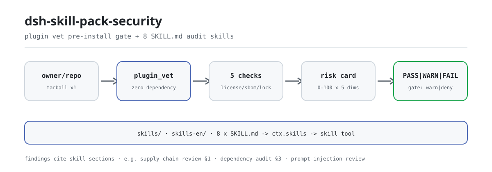
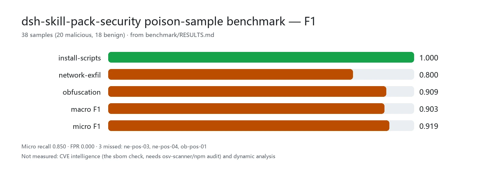

<div align="center">

<picture>
  <source media="(prefers-color-scheme: dark)" srcset="docs/assets/dsh-skill-pack-security-flow-dark.svg">
  
</picture>

# dsh-skill-pack-security

**Coloque o risco da cadeia de suprimentos na mesa antes do `dsh plugin add` — o veredito, não o palpite, decide a instalação.**

Oito skills de auditoria de segurança mais um portão automático de pré-instalação para o DeepSeek Harness: as skills ensinam a metodologia, o `plugin_vet` executa as verificações mecânicas e cada achado aponta de volta para a seção da skill correspondente.

[Instalar](#instalação-em-três-passos) · [Configuração](#configuração) · [FAQ](#faq) · [简体中文](README.md) · [English](README.en.md) · [Español](README.es.md) · [Português](README.pt.md) · [हिन्दी](README.hi.md)

[](LICENSE)
[](#compatibilidade)
[](https://github.com/PerryLink/dsh-skill-pack-security/actions/workflows/verify.yml)
[](#compatibilidade)

[](https://github.com/PerryLink/dsh-skill-pack-security/stargazers)
[](https://dshfind.com/plugins/PerryLink/dsh-skill-pack-security?ref=badge)
[](https://securityscorecards.dev/viewer/?uri=github.com/PerryLink/dsh-skill-pack-security)
[](https://dsh.market/)
[](https://gitee.com/perrylink/dsh-skill-pack-security)

```sh
dsh plugin --profile <name> add dsh-skill-pack-security
```

</div>

<sub>Plugin da comunidade, sem afiliação com a DeepSeek. Repositório canônico: <https://github.com/PerryLink/dsh-skill-pack-security> (o Gitee é um espelho).</sub>

<sub>Este projeto mudou para **[dsh-security-pack](https://github.com/PerryLink/dsh-security-pack)**: este repositório fica como índice e backup e o trabalho novo acontece lá; o pacote npm antigo `@perrylink/dsh-skill-pack-security-provider` está obsoleto.</sub>

## O que é

`dsh-skill-pack-security` é um **pacote de skills mais um portão de cadeia de suprimentos**. Oito metodologias de segurança são entregues como bundles `SKILL.md` que o modelo descobre no catálogo da sessão e carrega sob demanda, enquanto o `plugin_vet` executa as verificações mecânicas de pré-instalação — licença, SBOM, travamento de commit, scripts de ciclo de vida e domínios de exfiltração, um cartão de risco de cinco dimensões — e fecha com PASS / WARN / FAIL. As skills respondem "como eu audito isto"; a ferramenta responde "como o pacote vem antes de eu instalar"; as duas compartilham vocabulário e numeração de seções. O pacote raiz é um manifesto de bundle privado; o pacote executável é `@perrylink/dsh-skill-pack-security-provider`.

```text
owner/repo ──tarball (1x)──▶ plugin_vet ──▶ license · sbom · commit-lock
                                            lifecycle · exfil · obfuscation
                                            data-responsibility
                                   │
                                   ▼
                  cartão de risco (5 dims x 0-100) ──▶ PASS | WARN | FAIL ──▶ gate.policy
```

## Instalação em três passos

1. **Instalar** (escolha um canal; o pacote executável é o provider):

   ```sh
   # canal git (último main)
   dsh plugin --profile web add github:PerryLink/dsh-skill-pack-security
   # canal npm (versões publicadas, com provenance)
   dsh plugin --profile web add @perrylink/dsh-skill-pack-security-provider
   # canal tarball: após pnpm pack dentro de provider/
   dsh plugin --profile web add ./@perrylink-dsh-skill-pack-security-provider-<version>.tgz
   ```

   O `prepack` embute as duas edições — `skills/` (chinês) e `skills-en/` (inglês) — no tarball; a linha que é montada é a de `provider/cordis.patch.yml`.

2. **Configuração mínima** (por padrão publica a edição chinesa; uma chave troca):

   ```yaml
   - insert:
       - id: skill-pack-security
         name: '@perrylink/dsh-skill-pack-security-provider'
         config:
           language: en
   ```

3. **Verificar que está no ar**:

   ```sh
   dsh --profile web --dump-config | grep -A3 'id: skill-pack-security'
   ```

   Depois peça ao modelo para carregar `security-audit` com a ferramenta `skill` e chamar `plugin_vet` uma vez contra qualquer `owner/repo`: se voltar o cartão de risco, funciona.

**Desinstalar**: `dsh plugin --profile web remove @perrylink/dsh-skill-pack-security-provider` (ou remova a linha; cópias só de skills saem com `-Uninstall` / `--uninstall` do instalador).

<details>
<summary>Instalar pelo mercado do DSH Desktop</summary>

Todos os plugins PerryLink aparecem no mercado embutido do DSH Desktop: **Mercado → Fontes → Adicionar fonte → colar** `https://perrylink-dsh-catalog.perrylink.workers.dev/catalog-source.json` **→ selecionar**. A instalação continua passando pela verificação de identidade npm do mercado e pela sua confirmação.

</details>

### Instalar as skills manualmente

Não é preciso o provider para usar as skills. O provedor local de skills do DSH varre quatro raízes por rank (dentro de uma camada, o menor rank vence em nomes repetidos):

| Rank | Raiz | Escopo |
|---|---|---|
| 100 | `<projectRoot>/.dsh/skills` | Do projeto, viaja com o repositório |
| 200 | `<projectRoot>/.agents/skills` | Do projeto, diretório compartilhado entre agentes |
| 400 | `<dshHome>/skills` (`$DSH_HOME` ou `~/.dsh`) | Do usuário, só DSH |
| 500 | `<agentsHome>/skills` (`$DSH_AGENTS_HOME` ou `~/.agents`) | Do usuário, entre agentes |

Cadeia de rank (o menor vence nomes repetidos na camada): `project-dsh 100 < project-agents 200 < custom 300 < user-dsh 400 < user-agents 500`. O rank 300 é a camada registrada por plugins (como o `provider/` opcional deste pacote), não uma raiz em disco.

```powershell
./scripts/install.ps1 -Target user-agents -Language zh   # Target: project-dsh | project-agents | user-dsh | user-agents; Language: zh (padrão) | en
```

```sh
bash ./scripts/install.sh --target user-agents --language en
```

## Capacidades principais

- **Oito skills, duas edições** — cada skill é entregue com nomes e metadados idênticos em `skills/` (chinês) e `skills-en/` (inglês); instala-se um idioma por raiz.
- **Portão `plugin_vet`** — scanner sem dependências registrado em `ctx.tools` pelo plugin opcional `provider/` (licença / SBOM / travamento de commit / padrões maliciosos / revisão de responsabilidade de dados / cartão de risco de cinco dimensões).
- **Achados citam as skills** — cada achado aponta para a seção correspondente (por exemplo `supply-chain-review §1`), para o agente continuar a auditoria manual.
- **Executável por um modelo** — cada passo de uma skill é um comando real (`gitleaks`, `trivy`, `pnpm audit`, `npm view`, `git …`) com amostra de saída esperada e critério de código de saída.

### As oito skills

| Skill | Propósito | Quando usar |
|---|---|---|
| `security-audit` | Fluxo de auditoria em cinco fases: escopo → inventário → classificação de risco → verificação → modelo de relatório | Auditorias de repositório inteiro, relatórios, planejamento |
| `secret-scan` | Auditoria de credenciais: uso de gitleaks/trivy, níveis de falso positivo, relatórios redigidos, ordem de remediação | Varredura de segredos, triagem de alertas, relatórios de vazamento |
| `dependency-audit` | Auditoria da cadeia de suprimentos: leitura de pnpm/npm audit, licenças, risco de typosquat, deriva de lockfile | Revisão de dependências, interpretação de relatório de audit |
| `supply-chain-review` | Revisão rápida de PR/nova dependência: scripts de instalação perigosos, typosquat, builds reproduzíveis | Revisar PRs que adicionam dependências |
| `prompt-injection-review` | Revisão de superfícies de injeção em projetos de agentes: AGENTS.md, skills, descrições de ferramentas, MCP, web | Revisar superfícies de injeção do contexto do modelo |
| `threat-model` | Modelagem de ameaças em projeto: fronteiras de confiança, tabela STRIDE, árvores de ataque, mitigações | Modelar recursos novos, revisão de segurança em projeto |
| `vuln-intel` | Inteligência de vulnerabilidades: consultas NVD/CISA-KEV/GHSA/OSV com critérios de veredito | Com um id CVE/GHSA, checar impacto e exploração |
| `incident-response` | Resposta a incidentes em ambientes de agentes: conter → evidências → recuperar → postmortem | Suspeita de incidente de segurança em DSH/agentes |

Cada bundle mantém o arquivo principal em ≤ 300 linhas (divulgação progressiva; o detalhe vive em `references/`).

### plugin_vet — o portão automático de pré-instalação

O `plugin_vet` é o complemento automático do pacote: um scanner sem dependências registrado em `ctx.tools` pelo plugin `provider/`. Aponte para um `owner/repo` do GitHub ou um caminho de pacote local — ele baixa o tarball uma vez (respeitando timeout e `AbortSignal`), varre dentro dos limites de orçamento e devolve um cartão renderizado.

- **Varredura de licença** — localiza o arquivo LICENSE e o campo `license`; `NOASSERTION`/`UNKNOWN`/`SEE LICENSE IN <file>`, arquivo ausente ou campo ausente são sinalizados; ids SPDX comuns são reconhecidos.
- **SBOM** — extrai a árvore de dependências com versões do lockfile (pnpm/npm/yarn); quando `osv-scanner` ou `npm audit` é detectado em um alvo local, a saída de vulnerabilidades deles substitui a varredura autocalculada e o relatório anota a fonte (`builtin` / `osv-scanner` / `npm-audit`).
- **Travamento de commit** — refs do manifesto de instalação e actions de workflow precisam ser SHAs de commit imutáveis de 40 hex; refs `@tag`/branch são marcadas como mutáveis.
- **Padrões maliciosos** — scripts de ciclo de vida (`preinstall`/`install`/`postinstall`), domínios de exfiltração de rede e cargas ofuscadas/codificadas no código publicado.
- **Revisão de responsabilidade de dados** — as dimensões da varredura de política como regras determinísticas: listeners sem portão em seams sensíveis (`agent/pre-step`, `tools/pre-execute`, `session/event`, …), endpoints de saída sem divulgação de telemetria/privacidade no README, cobertura de palavras-chave descrição-comportamento e cargas de sobreposição de instruções embutidas no texto publicado (skills, docs, prompts, testes). Cada achado cita `prompt-injection-review` para a análise manual; desativa-se por implantação com `vet.dataResponsibility: false`. A etapa de revisão assistida por modelo é a melhoria futura documentada.
- **Relatório de risco de cinco dimensões** — licença / origem / dependências / scripts de build / manutenção, cada uma 0-100, resumidas em um veredito geral: PASS, WARN ou FAIL.

**Portão de instalação.** O veredito alimenta um portão de instalação — `gate.policy: warn` (padrão, não bloqueante) imprime um aviso em FAIL; `gate.policy: deny` devolve um veredito de negação. A ferramenta não intercepta o `dsh plugin add` do host; conecte o veredito ao seu instalador/CI para aplicá-lo:

```yaml
- id: skill-pack-security
  name: '@perrylink/dsh-skill-pack-security-provider'
  config:
    language: en
    vet:
      gate:
        policy: deny   # devolve veredito de negação para alvos que falham no plugin_vet (quem chama aplica)
```

**Complementa o `dsh-plugin-check`.** As 36 verificações do validador oficial checam o *contrato e a qualidade* do plugin (esquema de configuração, registro de effects, formato do JSON de ferramentas); o `plugin_vet` checa a *cadeia de suprimentos* de onde o plugin vem. Rode os dois:

| | `dsh-plugin-check` (36 verificações) | `plugin_vet` (este repositório) |
|---|---|---|
| Pergunta que responde | Este plugin está bem formado e em conformidade? | Este pacote é seguro de instalar? |
| O que olha | Código do plugin, esquema, registros, contratos de ferramentas | LICENSE, lockfile, refs/actions de instalação, scripts de ciclo de vida, exfiltração/ofuscação, manutenção, responsabilidade de dados (escopo de hooks, divulgação de telemetria, descrição-comportamento, cargas de injeção embutidas) |
| Veredito | Pass/fail por verificação | PASS / WARN / FAIL + portão |
| Quando | Desenvolvimento ou revisão do plugin | Antes do `dsh plugin add`, em revisão de PR, no portão de CI |
| Bloqueio | Portão de CI (diferente de zero em violações) | Configurável: `warn` (padrão) ou `deny` |

### Por que skills e não ferramentas

| Forma | O que faz | O que não consegue |
|---|---|---|
| Plugin de ferramenta (ex.: scanners) | *Executa* varreduras e devolve achados | Interpretar alertas, classificar falsos positivos, escrever relatórios redigidos |
| Camada de protocolo | *Restringe* um protocolo | Generalizar entre repositórios e agentes |
| **Pacote de skills (este repositório)** | *Ensina metodologia*: triagem, relatório, ordem de remediação — **e** automatiza as verificações estáticas de pré-instalação via `plugin_vet` | Substituir uma auditoria manual de ponta a ponta |

Instalado junto a um plugin de segurança do tipo ferramenta, os dois se compõem: a ferramenta roda a varredura, a skill conduz interpretação, triagem e relatório. Este pacote reúne as duas formas: as skills ensinam a metodologia e o `plugin_vet` roda o subconjunto estático mecânico, com cada achado apontando de volta para as skills.

As mais de 3000 skills do ecossistema Claude Code provam o valor de distribuição desta forma. O frontmatter `SKILL.md` do DSH (`name`, `description`, `whenToUse`) é compatível com o formato das skills de CC; este pacote usa só o subconjunto comum e seu conteúdo é inteiramente original.

### Ferramentas e superfícies

| Superfície | Tipo | Notas |
|---|---|---|
| `plugin_vet` | tool | Varredura de cadeia de suprimentos pré-instalação (licença / SBOM / travamento de commit / malicioso / cartão de risco); achados citam seções de skills |
| `skill-pack-security` | skill provider | Registra a edição `skills/` ou `skills-en/` do pacote em `ctx.skills` |
| Oito bundles `SKILL.md` | skills | A metodologia de auditoria, em duas edições de idioma |
| portão de instalação | gate | `vet.gate.policy: warn \| deny` devolve um veredito; quem chama (instalador/CI) aplica |

## Dados medidos

<picture>
  <source media="(prefers-color-scheme: dark)" srcset="docs/assets/dsh-skill-pack-security-evidence-en-dark.webp">
  
</picture>

A taxa de detecção, a taxa de falsos positivos e a F1 por classe sobre 38 amostras envenenadas (20 maliciosas, 18 benignas) estão publicadas em [`benchmark/RESULTS.md`](benchmark/RESULTS.md); regenere com `pnpm --dir provider run build && node benchmark/run.mjs` (sem dependências novas). O que se mede são as três verificações de padrões maliciosos do motor publicado — `installScriptsCheck`, `networkExfilCheck`, `obfuscationCheck`; só um veredito `fail` (o estado que bloqueia uma instalação na política `deny`) conta como detecção, um `warn` não conta. Recall micro 0.850, F1 macro 0.903, F1 micro 0.919 e zero falsos positivos. As três amostras não detectadas e a lacuna frente ao OSV/Socket estão escritas no RESULTS.md: essas heurísticas leem apenas a forma e não trazem base de vulnerabilidades, então a inteligência de CVE pertence à verificação `sbom` (precisa de `osv-scanner`/`npm audit`).

## Configuração

Todos os ajustes são campos Schemastery `Config` (alteráveis pelo cordis.yml). `provider/cordis.patch.yml` documenta cada chave inline.

Chaves mais usadas:

| Chave | Padrão | Significado |
|---|---|---|
| `language` | `zh` | Edição a publicar: `skills/` em chinês ou `skills-en/` em inglês; ignorada quando `skillsDir` está definido |
| `skillsDir` | *(não definido)* | Raiz de skills explícita; substitui o padrão derivado de `language` e precisa conter bundles `<skill>/SKILL.md` |
| `vet.enable` | `true` | Registra a ferramenta de portão `plugin_vet` |
| `vet.dataResponsibility` | `true` | Executa a revisão de responsabilidade de dados (desativável por implantação) |
| `vet.externalScanners` | `true` | Orquestra `osv-scanner`/`npm audit` quando seus CLIs estão presentes; `false` força a varredura de dependências autocalculada |
| `vet.gate.policy` | `warn` | Portão de instalação: `warn` (não bloqueante) ou `deny` (bloqueia em FAIL) |

<details>
<summary>Tabela de configuração completa (14 chaves)</summary>

| Chave | Padrão | Significado |
|---|---|---|
| `language` | `zh` | Edição a publicar: `skills/` em chinês ou `skills-en/` em inglês; ignorada quando `skillsDir` está definido |
| `watch` | `false` | Vigiar o diretório empacotado de skills (conteúdo estático, por isso desligado) |
| `skillsDir` | *(não definido)* | Raiz de skills explícita; substitui o padrão derivado de `language` e precisa conter bundles `<skill>/SKILL.md` |
| `vet.enable` | `true` | Registra a ferramenta de portão `plugin_vet` |
| `vet.timeoutMs` | `15000` | Timeout de download do tarball em ms |
| `vet.maxFiles` | `800` | Limite de arquivos varridos |
| `vet.maxFileBytes` | `262144` | Limite de bytes por arquivo |
| `vet.maxExtractBytes` | `67108864` | Limite de bytes extraídos |
| `vet.maxDepNodes` | `600` | Limite de nós da árvore de dependências |
| `vet.maxFindingsPerCheck` | `12` | Limite de achados por verificação |
| `vet.dataResponsibility` | `true` | Executa a revisão de responsabilidade de dados (desativável por implantação) |
| `vet.externalScanners` | `true` | Orquestra `osv-scanner`/`npm audit` quando seus CLIs estão presentes; `false` força a varredura de dependências autocalculada |
| `vet.userAgent` | `dsh-skill-pack-security/2.2.25 (+https://github.com/PerryLink/dsh-skill-pack-security)` | User-agent de download |
| `vet.gate.policy` | `warn` | Portão de instalação: `warn` (não bloqueante) ou `deny` (bloqueia em FAIL) |

</details>

Exemplo de sobreposição no patch do perfil:

```yaml
- insert:
    - id: skill-pack-security
      name: '@perrylink/dsh-skill-pack-security-provider'
      config:
        language: zh
        vet:
          gate:
            policy: deny
```

## FAQ

<details>
<summary>Para onde vão os dados varridos? O que sai da minha máquina?</summary>

O `plugin_vet` baixa o tarball alvo uma vez (respeitando `vet.timeoutMs` e `AbortSignal`), extrai e varre localmente, e redige texto com forma de segredo no relatório renderizado; o plugin não injeta seções de prompt nem envia relatórios a lugar algum. O manifesto `dshWorkshop` declara exatamente duas permissões: `files:read` e `network:fetch`. As skills são texto puro, sem código executável.

</details>

<details>
<summary>O que acontece quando falta uma dependência ou um recurso do host? Falha em silêncio?</summary>

Nada é silencioso. Um `skillsDir` vazio ou inexistente faz o provider falhar ruidosamente na montagem; quando `osv-scanner`/`npm audit` não existem, `vet.externalScanners` cai para a varredura autocalculada e anota a fonte no relatório; com `vet.enable: false` a ferramenta `plugin_vet` simplesmente não é registrada (as skills continuam funcionando).

</details>

<details>
<summary>Concorre com outros plugins de segurança? Ainda preciso do dsh-plugin-check oficial?</summary>

Não há concorrência: o plugin registra uma ferramenta (`plugin_vet`) e um conjunto de skills, e os nomes das skills não se sobrepõem às oficiais nem aos pacotes comunitários conhecidos (ver «Interoperabilidade com outros plugins DSH»). Continue rodando o `dsh-plugin-check` oficial: ele cobre contrato e qualidade, o `plugin_vet` cobre a cadeia de suprimentos; duas perguntas diferentes, duas réguas diferentes.

</details>

<details>
<summary>Qual é o custo de desempenho?</summary>

As verificações são heurísticas estáticas — sem dependências, sem execução dinâmica —, então o custo é um download de tarball mais a extração; quatro limites de orçamento (`vet.maxFiles` 800, `vet.maxFileBytes` 262144, `vet.maxExtractBytes` 67108864, `vet.maxDepNodes` 600) e um timeout de 15 segundos cercam o pior caso. Para a precisão medida, ver «Dados medidos» (38 amostras, F1 micro 0.919).

</details>

## Limites de segurança

- **Motor sem dependências.** O `plugin_vet` usa apenas builtins `node:` e imports relativos.
- **Portão pré-instalação de escopo estreito.** Não é uma ferramenta de auditoria de segurança geral — é deliberadamente complementar aos plugins scanners e ao validador de contrato oficial `dsh-plugin-check`.
- **Não bloqueante por padrão.** O portão de instalação é `warn` a menos que você opte por `deny`.
- **Conteúdo original.** Compatível com o formato de skills do Claude Code, mas sem copiar conteúdo de skills CC e sem marketplace de skills.
- **Motor original, sem ports de terceiros.** A varredura de licença e as verificações de padrões maliciosos são implementações originais sem dependências; os ativos GPL-Radar / LLM-detective / Sus-PY foram avaliados para port mas nenhuma fonte pública com licença verificável foi encontrada — ver `THIRD_PARTY_NOTICES.md`.

## Permissões e dados

- **Permissões**: o manifesto `dshWorkshop` declara `files:read` e `network:fetch`.
- **Dados**: o `plugin_vet` baixa um tarball uma vez (respeitando timeout e `AbortSignal`) e o relatório redige texto com forma de segredo; o plugin não injeta seções de prompt.
- **Log de sessão**: este plugin não declara nenhum tipo de evento de sessão, então o rastro de auditoria fica nos eventos `tool/call` + `tool/result` do host.

## Limitações conhecidas

- **Não é uma ferramenta de auditoria completa.** O `plugin_vet` é um portão de confiança pré-instalação de escopo estreito; não substitui uma auditoria manual de ponta a ponta.
- **Apenas varredura estática.** Os sinais de padrões maliciosos e de manutenção são heurísticas sobre o pacote publicado, não análise dinâmica.
- **Uma edição por raiz.** Skills de mesmo nome em uma raiz são resolvidas por rank, então só uma edição de idioma entra no catálogo da sessão.

## Interoperabilidade com outros plugins DSH

Este plugin toca exatamente dois seams: registra o `plugin_vet` em `ctx.tools` e a edição do pacote em `ctx.skills`. Não disputa nenhum nome existente e se compõe com plugins de segurança do tipo ferramenta.

- **Zero colisões de nome de skill.** Os oito nomes foram checados um a um contra o conjunto oficial `.agents/skills/` (12 skills, snapshot de 2026-08) e os pacotes comunitários conhecidos (`dsh-write-plugin`, `dsh-test-plugin`, `dsh-plugin-dev`, `make-dsh-plugin`, `find-plugins`, `mainline-compat`), sem sobreposição; `dhicoc/dsh-reverse-skill` (85 skills) e `cyzlmh/dsh-cyber-sec` (21 skills) também não têm skills com esses nomes. Método e resultados por consulta: [`docs/ecosystem-conflict-check.md`](docs/ecosystem-conflict-check.md) (snapshot de 2026-08-14); `verify/verify-skill-pack.mts` verifica mecanicamente na checagem 2.
- **Complementar a plugins de segurança do tipo ferramenta e protocolo.** As formas existentes neste tema são «ferramenta» e «protocolo»; este pacote é «skills mais um portão estático». A ferramenta roda a varredura, as skills conduzem interpretação, triagem e relatório — superfícies diferentes, sem concorrência.
- **Complementar ao `dsh-plugin-check` oficial.** 36 verificações de contrato contra uma verificação de cadeia de suprimentos; a tabela comparativa está em «Capacidades principais».
- **O bundle insere apenas a própria linha.** `provider/cordis.patch.yml` faz `insert` de exatamente uma linha `skill-pack-security` e nunca sobrescreve o `config` de uma linha embutida.

## Compatibilidade

| Superfície | Status |
|---|---|
| Harness | DeepSeek Harness **`dsh-v0.2.1-alpha.1`** (tag do GitHub, verificado em 2026-09-25: cadeia de portões completa + instalação de perfil de fumaça). Linha de dependência npm: `@deepseek-ai/dsh` **0.1.5-rc.2** (peers `>=0.1.2-rc.1 <0.2.0 \|\| >=0.1.5-alpha.1 <0.2.0`). O envelope de sessão mantém seu campo ignorable apenas por compatibilidade de leitura de logs salvos — o Session.append continua sem conseguir estampá-lo, então o comportamento do portão de auditoria não muda. |
| Node | `^22.19.0 \|\| >=24.0.0` (o runtime do DeepSeek Harness) |
| Plataformas | Todas (as skills são conteúdo; o provider é um plugin de host). O CI roda as 25 verificações em Ubuntu e Windows |
| Modelo | Qualquer (as skills carregam sob demanda pela ferramenta `skill`; o `plugin_vet` é determinístico) |

## Ecossistema e qualidade

- [Espelho no Gitee](https://gitee.com/perrylink/dsh-skill-pack-security) (espelho sincronizado; o GitHub é o canônico)
- [Página do plugin no dshfind](https://dshfind.com/plugins/PerryLink/dsh-skill-pack-security) (instalações e ranking)
- [Relatório OpenSSF Scorecard](https://securityscorecards.dev/viewer/?uri=github.com/PerryLink/dsh-skill-pack-security) (movido por [.github/workflows/scorecard.yml](.github/workflows/scorecard.yml))
- [Auditoria estática do dsh-plugin-doctor](.github/workflows/plugin-doctor.yml) (roda os critérios R+K da SPEC em cada push/PR)
- [DSH Market](https://dsh.market/) (listado)
- **Canal da loja 1024**: `npm i -g dsh1024` uma vez e depois `dsh1024 plugin --profile web add dsh-skill-pack-security` (conta para o ranking de instalações do [deepseek1024.com](https://deepseek1024.com))
- [Base de conhecimento do ecossistema](https://perrylink.github.io/dsh-plugin-guide/) — dados medidos, não marketing: guia de desenvolvimento de plugins · dados de seleção · critérios de manutenção

### Roteiro

- `dsh-skill-pack-data-engineering` — pipelines de dados, qualidade de dados, checklists ETL (mesmo modelo)
- `dsh-skill-pack-oss-collab` — etiqueta de PR, triagem de issues, fluxos de mantenedores
- `dsh-skill-pack-performance` — metodologia de profiling, critérios de benchmark, checklists de regressão
- Mais skills dentro deste pacote (mesmo limite de só skills): `sbom-lifecycle` (geração, envelhecimento e importação de SBOM), `pen-test-review` (escopo de testes autorizados e revisão de relatório), `compliance-audit` (percursos ASVS/NIST-CSF)
- Manter frescos os artefatos de demo do `plugin_vet` (`docs/demos/run-demos.mjs`) e precisa a tabela de complemento do `dsh-plugin-check` conforme o validador oficial adiciona verificações

## Desenvolvimento

```sh
pnpm --dir provider run typecheck   # tsc --noEmit
pnpm --dir provider run build       # tsc --noEmitOnError
pnpm --dir provider run prepack     # embute as duas edições de skills no tarball
tsx verify/verify-skill-pack.mts    # verificação headless de 25 checagens
node benchmark/run.mjs              # conjunto de regressão de amostras envenenadas (build antes)
pnpm run check:readmes              # consistência dos README em cinco idiomas
```

O diagrama de capa e o gráfico de dados medidos são gerados programaticamente por [`scripts/gen-readme-assets.py`](scripts/gen-readme-assets.py) (Python + Pillow) e podem ser reexecutados: `python scripts/gen-readme-assets.py`.

### Verificação: 25 checagens headless

`verify/verify-skill-pack.mts` importa o parser **oficial** `dsh-skill-filesystem`, a ferramenta `skill` **real** e o runtime de ferramentas **real** de um checkout local do `deepseek-harness` e verifica 25 checagens nas duas edições de idioma:

1. Estrutura: as duas edições presentes, 8 bundles de diretório cada, sem skills planas soltas, `name` do frontmatter igual ao diretório, ≤ 300 linhas, `references/` ligado, `metadata.version` sincronizado com o arquivo `VERSION`
2. Sem conflitos de nome com as skills oficiais de `.agents/skills/` (derivadas do checkout em tempo de execução) nem com pacotes comunitários conhecidos
3–6. Por edição (`skills/` chinesa, `skills-en/` inglesa): descoberta no registro pelo provider oficial, carga completa via `ctx.skills.get()`, a ferramenta `skill` real devolvendo `<skill_content>` (nomes desconhecidos/inválidos recusados) e o catálogo de sessão contendo só `name` + `description` — `whenToUse` fica fora do catálogo do modelo (desenho oficial)
7. 13 fixtures de frontmatter ruim exercitam as regras fail-closed oficiais (campos ausentes, chaves camel-case legadas, valores não booleanos, nomes não kebab, diretórios aninhados, nome divergente); skills em arquivo plano carregam e `**/SKILL.md` aninhado não é descoberto
8. O plugin provider opcional monta a edição chinesa e a inglesa via `ctx.effect()`, descarta limpo e recusa configuração errada (`skillsDir` vazio ou inexistente)
9–15. Checagens de autoendurecimento: paridade estrutural zh↔en, ligação de references (sem arquivos pendurados ou órfãos), sincronia de versão do provider, ranks documentados contra as constantes oficiais, padrões `grep -E` portáveis para POSIX, autochecagem de segredos, release-checklist segura em UTF-8
16–19. `plugin_vet` pelo runtime de ferramentas real: registra em `ctx.tools`; o fixture conforme passa; o fixture sem licença falha e cita `dependency-audit §3`; o fixture com postinstall malicioso falha (scripts/exfiltração/ofuscação, citando `supply-chain-review §1`); o portão devolve veredito de negação com `policy: deny` (quem chama aplica)
20. O motor de varredura não tem dependências (só builtins `node:` e imports relativos)
21. A redação do relatório mantém texto com forma de segredo fora da saída renderizada

```powershell
# local: resolve automaticamente o checkout do harness ao lado do pacote, ou aponte explicitamente
$env:DSH_HARNESS_CHECKOUT = 'D:\deepseek-harness'
& D:\deepseek-harness\node_modules\.bin\tsx.CMD verify\verify-skill-pack.mts
# All 25 checks passed for dsh-skill-pack-security.
```

As mesmas 25 checagens rodam no GitHub a cada push via `.github/workflows/verify.yml` — em Ubuntu e Windows —, além de um exercício de `install.sh`/`install.ps1` e de uma fumaça de build/pack do provider que verifica se o tarball leva as duas edições embutidas e o patch do bundle.

### Estrutura do repositório

| Caminho | O que é |
|---|---|
| `skills/<name>/SKILL.md` | As oito skills (edição chinesa); frontmatter segue o contrato oficial `dsh-skill-filesystem` |
| `skills-en/<name>/SKILL.md` | As oito skills (edição inglesa); mesmos nomes e metadados da chinesa |
| `skills/<name>/references/` | Detalhe de divulgação progressiva: matrizes de comandos, tabelas de triagem, modelos |
| `scripts/install.ps1` | Instalador Windows de um comando para as quatro raízes (duas edições); registra manifesto, aceita `-Uninstall`/`-DryRun`/`-Force` |
| `scripts/install.sh` | O equivalente POSIX (`--uninstall`/`--dry-run`/`--force`) |
| `provider/` | Bundle provider instalável por npm (declara `dsh.bundle`; embute as duas edições em `pack/` via `prepack`; `language: zh\|en`); registra o provedor de skills E a ferramenta de portão `plugin_vet` via `ctx.effect()`, falhando ruidosamente com `skillsDir` errado |
| `provider/src/vet/` | O motor de varredura `plugin_vet` sem dependências (licença / SBOM / travamento de commit / padrões maliciosos / relatório de risco) |
| `package.json` | Manifesto do bundle raiz: declara `dsh.bundle.patch` (→ `provider/cordis.patch.yml`) e os fatos de intake do `dshWorkshop` |
| `verify/verify-skill-pack.mts` | Verificação headless contra o parser oficial, a ferramenta `skill` real e o runtime de ferramentas real — 25 checagens nas duas edições |
| `VERSION` | Fonte única de versão; cada `metadata.version` de SKILL.md e o `provider/package.json` precisam coincidir (imposto pelo CI) |
| `benchmark/` | O conjunto de regressão de amostras envenenadas (`dataset/poison.json`, `run.mjs`, `RESULTS.md`) |
| `docs/` | Checagem de conflito do ecossistema, checklist de release, planos de melhoria e as demos do `plugin_vet` (`docs/demos/`) |
| `CHANGELOG.md` / `SECURITY.md` / `CONTRIBUTING.md` | Histórico de versões, política de relato de vulnerabilidades e regras de contribuição/verificação |
| `.github/workflows/verify.yml` | CI: 25 checagens + exercício do instalador + fumaça de build/pack do provider (Ubuntu e Windows) |
| `.github/dependabot.yml` | Atualizações semanais de dependências do provider e do GitHub Actions |
| `LICENSE` | Apache License 2.0 |
| `THIRD_PARTY_NOTICES.md` | Postura de terceiros: motor sem dependências, ativos avaliados mas não portados, licenças das peer dependencies |

## Família e agradecimentos

Este projeto faz parte da família de plugins DeepSeek Harness da [PerryLink](https://github.com/PerryLink) (todos Apache-2.0). Se for útil, **uma estrela ajuda a próxima pessoa a encontrá-lo** — nada fica bloqueado por trás dela.

- [@PerryLink](https://github.com/PerryLink) — autor e mantenedor: as oito skills nas duas edições, os instaladores, a suíte de verificação, o bundle provider, o CI e a documentação.

<details>
<summary>Expandir os 95 plugins</summary>

| Plugin | Status |
|---|---|
| **[dsh-aqua-input-check](https://github.com/PerryLink/dsh-aqua-input-check)** |  |
| **[dsh-archive-check](https://github.com/PerryLink/dsh-archive-check)** |  |
| **[dsh-auto-review](https://github.com/PerryLink/dsh-auto-review)** |  |
| **[dsh-autotier](https://github.com/PerryLink/dsh-autotier)** | 🧊 CONGELADO — ver o README do repo |
| **[dsh-background-agents](https://github.com/PerryLink/dsh-background-agents)** | 🚫 APOSENTADO (repo arquivado) |
| **[dsh-bid-ca-precheck](https://github.com/PerryLink/dsh-bid-ca-precheck)** |  |
| **[dsh-bid-qual-check](https://github.com/PerryLink/dsh-bid-qual-check)** |  |
| **[dsh-budget](https://github.com/PerryLink/dsh-budget)** | 🧊 CONGELADO — ver o README do repo |
| **[dsh-cert-mcp](https://github.com/PerryLink/dsh-cert-mcp)** | 🧊 CONGELADO — ver o README do repo |
| **[dsh-checkpoint-rewind](https://github.com/PerryLink/dsh-checkpoint-rewind)** |  |
| **[dsh-claude-move](https://github.com/PerryLink/dsh-claude-move)** | 🧊 CONGELADO — ver o README do repo |
| **[dsh-click](https://github.com/PerryLink/dsh-click)** |  |
| **[dsh-composer-history](https://github.com/PerryLink/dsh-composer-history)** |  |
| **[dsh-contract-stance](https://github.com/PerryLink/dsh-contract-stance)** |  |
| **[dsh-customs-doc-check](https://github.com/PerryLink/dsh-customs-doc-check)** |  |
| **[dsh-data-quality](https://github.com/PerryLink/dsh-data-quality)** | 🧊 CONGELADO — ver o README do repo |
| **[dsh-defend](https://github.com/PerryLink/dsh-defend)** | 🧊 CONGELADO — ver o README do repo |
| **[dsh-demurrage-ledger](https://github.com/PerryLink/dsh-demurrage-ledger)** |  |
| **[dsh-doublecheck](https://github.com/PerryLink/dsh-doublecheck)** |  |
| **[dsh-draw](https://github.com/PerryLink/dsh-draw)** | 🧊 CONGELADO — ver o README do repo |
| **[dsh-drill-script-check](https://github.com/PerryLink/dsh-drill-script-check)** |  |
| **[dsh-eia-guide-check](https://github.com/PerryLink/dsh-eia-guide-check)** |  |
| **[dsh-emergency-plan](https://github.com/PerryLink/dsh-emergency-plan)** |  |
| **[dsh-essay-rubric-check](https://github.com/PerryLink/dsh-essay-rubric-check)** |  |
| **[dsh-evidence-check](https://github.com/PerryLink/dsh-evidence-check)** |  |
| **[dsh-export-ctl-check](https://github.com/PerryLink/dsh-export-ctl-check)** |  |
| **[dsh-fast](https://github.com/PerryLink/dsh-fast)** |  |
| **[dsh-fmea-table-check](https://github.com/PerryLink/dsh-fmea-table-check)** |  |
| **[dsh-forecast-penalty](https://github.com/PerryLink/dsh-forecast-penalty)** |  |
| **[dsh-fund-research](https://github.com/PerryLink/dsh-fund-research)** |  |
| **[dsh-github](https://github.com/PerryLink/dsh-github)** |  |
| **[dsh-gongwen-flow-check](https://github.com/PerryLink/dsh-gongwen-flow-check)** |  |
| **[dsh-gongwen-word-check](https://github.com/PerryLink/dsh-gongwen-word-check)** |  |
| **[dsh-guard-plan-qc](https://github.com/PerryLink/dsh-guard-plan-qc)** |  |
| **[dsh-hazchem-check](https://github.com/PerryLink/dsh-hazchem-check)** |  |
| **[dsh-hazplan-check](https://github.com/PerryLink/dsh-hazplan-check)** |  |
| **[dsh-hidden-risk-map](https://github.com/PerryLink/dsh-hidden-risk-map)** |  |
| **[dsh-hs-classify](https://github.com/PerryLink/dsh-hs-classify)** |  |
| **[dsh-icd-rule-check](https://github.com/PerryLink/dsh-icd-rule-check)** |  |
| **[dsh-industry-research](https://github.com/PerryLink/dsh-industry-research)** |  |
| **[dsh-lawcite-adapter](https://github.com/PerryLink/dsh-lawcite-adapter)** |  |
| **[dsh-laya](https://github.com/PerryLink/dsh-laya)** |  |
| **[dsh-lc-doc-check](https://github.com/PerryLink/dsh-lc-doc-check)** |  |
| **[dsh-learning-gap-check](https://github.com/PerryLink/dsh-learning-gap-check)** |  |
| **[dsh-library](https://github.com/PerryLink/dsh-library)** |  |
| **[dsh-local-ai](https://github.com/PerryLink/dsh-local-ai)** |  |
| **[dsh-lsp-actions](https://github.com/PerryLink/dsh-lsp-actions)** |  |
| **[dsh-mask](https://github.com/PerryLink/dsh-mask)** |  |
| **[dsh-mcp-panel](https://github.com/PerryLink/dsh-mcp-panel)** |  |
| **[dsh-medrec-qc](https://github.com/PerryLink/dsh-medrec-qc)** |  |
| **[dsh-memento](https://github.com/PerryLink/dsh-memento)** | 🧊 CONGELADO — ver o README do repo |
| **[dsh-nsfc-form-check](https://github.com/PerryLink/dsh-nsfc-form-check)** |  |
| **[dsh-nurse-record-check](https://github.com/PerryLink/dsh-nurse-record-check)** |  |
| **[dsh-observe](https://github.com/PerryLink/dsh-observe)** |  |
| **[dsh-origin-rvc-check](https://github.com/PerryLink/dsh-origin-rvc-check)** |  |
| **[dsh-ota-review-check](https://github.com/PerryLink/dsh-ota-review-check)** |  |
| **[dsh-output-styles](https://github.com/PerryLink/dsh-output-styles)** |  |
| **[dsh-paper-doc-adapter](https://github.com/PerryLink/dsh-paper-doc-adapter)** |  |
| **[dsh-permission-rules](https://github.com/PerryLink/dsh-permission-rules)** |  |
| **[dsh-permit-report-check](https://github.com/PerryLink/dsh-permit-report-check)** |  |
| **[dsh-pipeline-check](https://github.com/PerryLink/dsh-pipeline-check)** |  |
| **[dsh-pleading-draft](https://github.com/PerryLink/dsh-pleading-draft)** |  |
| **[dsh-plugin-doctor](https://github.com/PerryLink/dsh-plugin-doctor)** | 🚫 APOSENTADO (repo arquivado) |
| **[dsh-plugin-guide](https://github.com/PerryLink/dsh-plugin-guide)** |  |
| **[dsh-plugin-kit](https://github.com/PerryLink/dsh-plugin-kit)** | 🚫 APOSENTADO (repo arquivado) |
| **[dsh-plugin-upgrade](https://github.com/PerryLink/dsh-plugin-upgrade)** | 🚫 APOSENTADO (repo arquivado) |
| **[dsh-policy-brief-draft](https://github.com/PerryLink/dsh-policy-brief-draft)** |  |
| **[dsh-power-loss-split](https://github.com/PerryLink/dsh-power-loss-split)** |  |
| **[dsh-power-ticket-check](https://github.com/PerryLink/dsh-power-ticket-check)** |  |
| **[dsh-ppap-check](https://github.com/PerryLink/dsh-ppap-check)** |  |
| **[dsh-protest-deadline](https://github.com/PerryLink/dsh-protest-deadline)** |  |
| **[dsh-railway-window](https://github.com/PerryLink/dsh-railway-window)** |  |
| **[dsh-reach](https://github.com/PerryLink/dsh-reach)** | 🧊 CONGELADO — ver o README do repo |
| **[dsh-repair-order-qc](https://github.com/PerryLink/dsh-repair-order-qc)** |  |
| **[dsh-research-report](https://github.com/PerryLink/dsh-research-report)** |  |
| **[dsh-review-reply-check](https://github.com/PerryLink/dsh-review-reply-check)** |  |
| **[dsh-rulefile-check](https://github.com/PerryLink/dsh-rulefile-check)** |  |
| **[dsh-safety-brief-check](https://github.com/PerryLink/dsh-safety-brief-check)** |  |
| **[dsh-score](https://github.com/PerryLink/dsh-score)** | 🧊 CONGELADO — ver o README do repo |
| **[dsh-session-pin](https://github.com/PerryLink/dsh-session-pin)** | 🚫 APOSENTADO (repo arquivado) |
| **[dsh-session-sync](https://github.com/PerryLink/dsh-session-sync)** |  |
| **[dsh-site-log-check](https://github.com/PerryLink/dsh-site-log-check)** |  |
| **[dsh-skill-pack-security](https://github.com/PerryLink/dsh-skill-pack-security)** |  |
| **[dsh-soe-decision-check](https://github.com/PerryLink/dsh-soe-decision-check)** |  |
| **[dsh-soilwater-check](https://github.com/PerryLink/dsh-soilwater-check)** |  |
| **[dsh-sop-sync-check](https://github.com/PerryLink/dsh-sop-sync-check)** |  |
| **[dsh-spc-gbt-adapter](https://github.com/PerryLink/dsh-spc-gbt-adapter)** |  |
| **[dsh-talk](https://github.com/PerryLink/dsh-talk)** |  |
| **[dsh-team-rooms](https://github.com/PerryLink/dsh-team-rooms)** | 🚫 APOSENTADO (repo arquivado) |
| **[dsh-tender-extract](https://github.com/PerryLink/dsh-tender-extract)** |  |
| **[dsh-tender-matrix](https://github.com/PerryLink/dsh-tender-matrix)** |  |
| **[dsh-test-drive](https://github.com/PerryLink/dsh-test-drive)** |  |
| **[dsh-ticktick](https://github.com/PerryLink/dsh-ticktick)** | 🚫 APOSENTADO (repo arquivado) |
| **[dsh-translate](https://github.com/PerryLink/dsh-translate)** |  |
| **[dsh-warranty-calc](https://github.com/PerryLink/dsh-warranty-calc)** |  |

</details>

## Licença

[LICENSE](LICENSE) (Apache License 2.0) © 2026 dsh-skill-pack-security contributors

<p align="center"><sub>Apache-2.0 · Plugin da comunidade, sem afiliação com a DeepSeek.</sub></p>
